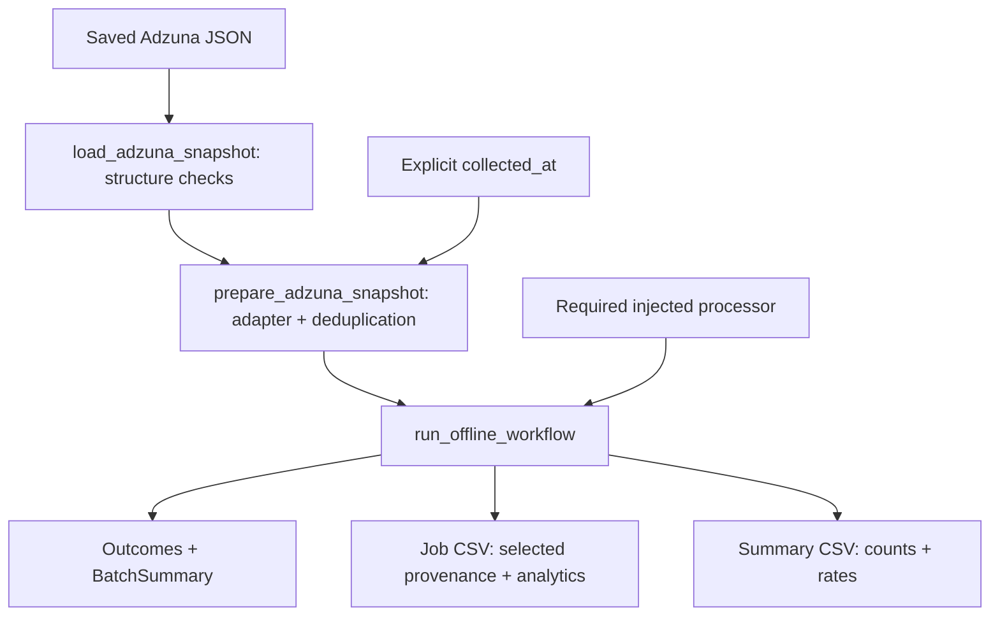

# UK Job Market Agents — Course Progress

**Status:** Active
**Last updated:** 12 November 2026
**Repository:** `uk-job-market-agents`
**Purpose:** A practical, test-driven Python course for building AI-assisted analysis of UK job advertisements, with a focus on data engineering, data science, data analytics and analytics engineering.

> **Source of truth:** This is a course handover assembled from our working sessions, not an automated audit of the repository. Confirm exact lesson numbers, branches and test counts with Git before treating them as definitive.

## 1. Learning goals

- Become more confident with Python development environments, package structure, Git, and tests.
- Learn when deterministic rules outperform LLMs, when LLMs help, and how to evaluate both.
- Build reusable agents and analysis workflows for real UK job-market data.
- Produce explainable, validated outputs that can inform a practical job search.
- Work in small steps: understand the concept, write or adjust tests, implement, run the suite, review and commit.

## 2. Current technical baseline

| Area | Current understanding |
| ---- | --------------------- |
| Language | Python 3.10.20 |
| Environment | Local `.venv` |
| Project packaging | `pyproject.toml` |
| Dependencies | `pydantic>=2,<3`, `openai`, `requests>=2.32,<3` |
| Tests | `pytest`, with `src` on `pythonpath` and `tests` as test path |
| Version control | Git; remote repository with `main` and lesson branches |
| Data | Five hand-labelled (“golden”) job adverts used for early evaluation |
| Model use | OpenAI API integrated for LLM classification and salary extraction |
| Secrets | `secrets.json` excluded from Git via `.gitignore` |

Current `pyproject.toml`:

```toml
[project]
name = "uk-job-market-agents"
version = "0.1.0"
requires-python = ">=3.10"
dependencies = [
    "pydantic>=2,<3",
    "openai",
    "requests>=2.32,<3"
]

[tool.pytest.ini_options]
pythonpath = ["src"]
testpaths = ["tests"]
```

**Environment note:** We have previously needed to reinstall `pytest` in the virtual environment. Before a lesson, confirm the active interpreter and dependencies rather than assuming they are installed.

## 3. Curriculum and progress

The table is organised by **topic**, not an asserted canonical lesson numbering. Use Git history and existing lesson branches to reconcile the original numbering.

| Topic | Status | Evidence / outcomes |
|---|---|---|
| Project foundations and domain models | Completed | Job-advert models and enumerations established. |
| Deterministic classification | Completed | Rules classify `WorkPattern` and `RoleFamily`. |
| LLM-based classification | Completed | OpenAI API connected; `classify_with_llm` issue resolved; API quota issue resolved. |
| Rules vs LLM comparison | Completed | CLI comparison output developed and formatted. |
| Evaluation metrics | Completed | Accuracy and disagreement measures added. |
| Disagreement analysis | Completed | Investigation of differing predictions and their causes. |
| Lesson 7 — Analytics integration | Completed | Deterministic salary summaries, guarded comparisons and analysis-ready output rows. |
| Lesson 8 — CSV export | Completed | Deterministic salary analysis CSV serialization. |
| Lesson 9 — Salary contract | Completed | SalaryQuote, SalaryPeriod and annual salary eligibility policy. |
| Lesson 10 — Portfolio hardening | Completed | CSV contract regression tests, documentation and GitHub Actions CI. |
| Lesson 11 — Salary extraction | Completed | Evidence-grounded extraction, deterministic verification and review states. |
| Lesson 12 — Salary extraction CSV and integration | Completed | Auditable extraction CSV, salary eligibility policy and analytics integration tests; commit `ce6deed`. |
| Lesson 13 — Company and location contracts | Completed | Company and raw location preserved in analytical contracts; commit `5c899ae`. |
| Lesson 14 — Orchestration | Completed | Single-job classification, salary verification and analytical record construction through `process_job()`; commit `6dc5650`. |
| Lesson 15 — Batch Orchestration and Processing Outcomes | Completed | Sequential batch processing, validated outcomes, failure isolation; commit `25acb8a`. |
| Lesson 16 — Batch Operational Metrics | Completed | Deterministic counts, calculated rates and Pydantic invariants; commit `c9be38a`. |
| Lesson 17 — Batch Metrics Reporting Contracts | Completed | Deterministic CSV export, seven-column schema and four passing tests; commit `3f91a68`. |
| Lesson 18 — Job Advertisement Ingestion Contract | Completed; integrated into `main` | Stronger source validation, timezone-aware timestamps, URL provenance, raw-text validation and 19 new passing tests; commit `6a94fea`. |
| Lesson 19 — Source Adapters and Provenance | Completed; integrated into `main` | Adzuna adapter, description completeness and orchestration provenance; commit `2236261`. |
| Lesson 20 — Adzuna API Client and Ingestion Pipeline | Completed; integrated into local `main` | Client `180bb76`; ingestion and deduplication `a3068b1`. |
| Lesson 21 — Adzuna Live Smoke and Snapshot Replay | Completed; committed | Offline default, explicit live mode, provider metadata and offline regression coverage; commit `28fd5dc`. |
| Lesson 22 — Offline Batch Integration | Committed at `9a672ee` | Injectable `run_postings_batch()` returns outcomes and a batch summary; four integration tests. |
| Lesson 23 — Provenance-aware export | Committed at `dc2eeb6` | Typed rows, stable CSV and 15 focused tests. |
| Lesson 24 — End-to-End Offline Workflow | Committed at `3c4b8df` | Required injected processor, two existing CSV writers, 12 new cases. |
| Lesson 25 — Processing policy | Committed at `bfac158`; integrated into local `main` | COMPLETE-only salary extraction; skipped assessments and provider predictions remain distinct. |
| Lesson 26 — Snapshot-backed offline execution | Committed at `507f7b1` | Three snapshot modules and three test files; 16 snapshot cases pass. |
| Lesson 27 — Snapshot CLI | Implemented and tested; uncommitted | Explicit agent mode, exit codes, CSV exports and documented operational limits. |
| Lesson 28 — Controlled live run | Completed; user-verified | Five ads; 4 processed, 1 review required, 0 failed; see handover below. |
| Lesson 29 — Deterministic data quality evaluation | Committed at `4315400` | Six coverage metrics, validated counts/rates and consistent denominators; 7 focused passed; full 332 passed, 1 known xfailed. |
| Lesson 30 — Analysis-ready dataset | Committed at `1a00a7c` | Independent role/salary selectors and validated sample accounting; 8 focused passed; full offline 338 passed, 2 skipped, 1 known xfailed. |
| Lesson 31 — Grouped analytical summaries | Committed at `9d62a81` | Role-family counts and verified salary coverage within eligible roles. |
| Lesson 32 — Analytical report composition | Reviewed; pending integration | Composed eligibility and grouping with report-level reconciliation; 9 focused passed; full offline 357 passed, 2 skipped, 1 known xfailed. |
| Lesson 33 — Analytical report CSV export | Reviewed offline | Added deterministic sample and group CSVs. Seven focused passed. Full offline suite yielded 364 passed, 2 skipped and 1 known xfailed. |
| Lesson 34 — Safe report CSV publication | Reviewed offline | Staged both CSVs before individual replacements. 17 focused passed. Full offline suite yielded 374 passed, 2 skipped and 1 known xfailed. |

### Domain vocabulary

`WorkPattern`: `REMOTE`, `HYBRID`, `ONSITE`, `UNKNOWN`.

`RoleFamily`: `data_engineering`, `data_science`, `data_analytics`, `analytics_engineering`.

The five initial labelled adverts included data engineering, data science and data analyst examples, covering remote and hybrid arrangements.

### Early evaluation example

On five golden adverts (a **small teaching set**, not a statistically robust benchmark):

| Measure | Rules | LLM |
|---|---:|---:|
| Role-family accuracy | 5/5 (100%) | 4/5 (80%) |
| Work-pattern accuracy | 4/5 (80%) | 5/5 (100%) |
| Full-record accuracy | 4/5 (80%) | 4/5 (80%) |

Observed disagreement rate: **40%**. These results describe one early evaluation run and should not be presented as general model performance.

### CSV export contract

The `write_salary_analysis_csv` export was documented to use this column order:

```csv
dimension,segment,records,records_with_salary,average_midpoint,has_sufficient_sample
```

Design expectations: deterministic ordering/output, consistent schema, and explicit handling of insufficient sample sizes. Confirm the exact implementation and handling of empty data against `output.py` and its tests.

## 4. Git and testing history

### Branch history

| Branch | Purpose |
| --- | --- |
| `main` | Stable integration branch |
| `lesson/05-evaluation-metrics` | Classification evaluation metrics |
| `lesson/06-disagreement-analyis` | Disagreement analysis |
| `lesson/07-analytics-integration` | Salary analytics and output rows |
| `lesson/08-csv-export` | CSV serialization |
| `lesson/09-salary-contract` | Salary validation and eligibility policy |
| `lesson/10-output-contract-ci` | CSV contract tests and GitHub Actions |
| `lesson/11-salary-extraction` | Evidence-grounded salary extraction |
| `lesson/12-salary-extraction-csv` | Salary extraction CSV and analytics eligibility integration |
| `lesson/13-company-location-contracts` | Company and location metadata contracts |
| `lesson/14-orchestration` | Single-job classification and salary orchestration |
| `lesson/15-batch-orchestration` | Sequential batch processing and validated processing outcomes |
| `lesson/16-batch-metrics` | Deterministic batch summaries and operational rates |
| `lesson/17-batch-reporting` | Deterministic batch-metrics CSV serialization |
| `lesson/18-ingestion-contract` | Strengthen canonical job-advertisement ingestion validation |
| `lesson/19-source-adapters` | Source adapters and provenance |
| `lesson/20-adzuna-api` | Adzuna API client and ingestion pipeline |
| `lesson/21-adzuna-live-smoke` | Controlled smoke and offline snapshot replay; commit `28fd5dc` |
| `lesson/22-offline-batch-integration` | Prepared-posting batch integration; commit `9a672ee` |
| `lesson/23-provenance-aware-export` | Provenance-aware analytical export; commit `dc2eeb6` |
| `lesson/24-offline-workflow` | Offline processing/export composition; commit `3c4b8df` |
| `lesson/25-processing-policy` | COMPLETE-only salary extraction; commit `bfac158` |
| `lesson/26-snapshot-execution` | Snapshot-backed offline execution; committed at `507f7b1` |

**Current working branch.** `lesson/33-analytical-report-export` starts at
`607957b` (Lesson 32). The Lesson 33 writer and tests were untracked at the
start of review.

**Lesson 27 baseline:** `507f7b1` (Lesson 26), verified 4 November 2026.
Seven CLI source/test files were already staged on arrival. This close-out adds
unstaged documentation, parser-help and test changes; the index is preserved.

**Lesson 25 baseline:** `3c4b8df` (Lesson 24), verified 2 November 2026.

**Lesson 24 starting baseline:** `dc2eeb6` (Lesson 23), clean working tree verified 30 October 2026.

Lesson 18 was committed, pushed and integrated into `main` at `6a94fea`.
Lesson 19 is integrated into `main` at `2236261`.
The Lesson 20 API client milestone is committed at `180bb76`.
Lesson 20 ingestion and deduplication are committed at `a3068b1`, the historical
Lesson 20 baseline. Lesson 21 is committed at `28fd5dc`.
Lesson 22 is committed at `9a672ee`; Lesson 23 is committed at `dc2eeb6`.
Lesson 24 is committed at `3c4b8df`; Lesson 25 is committed at `bfac158`.
Lesson 26 is committed at `507f7b1`; Lesson 27 remains uncommitted;
this documentation close-out performs no staging, commit, merge or push.

### Testing history

Earlier milestones included 24, 27 and 44 passing tests, each with one expected failure.
Historical full-suite snapshots: Lesson 17 — 171 passed, 1 xfailed;
Lesson 18 — 190 passed, 1 xfailed; Lesson 19 — 199 passed, 1 xfailed.
The Lesson 18 `test_job_posting.py` snapshot contained 23 passing tests.

**Verified Lesson 21 results (27 October 2026):** focused smoke, ingestion and
model tests **74 passed**; full suite **240 passed, 2 skipped, 1 xfailed**.
The skips require `OPENAI_API_KEY`; the expected failure is the known
remote-first / mandatory office-attendance classification rule case.
Local snapshot replay: **5 retrieved / 5 unique validated postings**.

**Latest confirmed Lesson 22 result (28 October 2026):** **246 passed,
1 xfailed in 4.71s**; focused integration tests **4 passed**.
`git diff --check` was clean. The latest output reports no skips; these results
do not establish live end-to-end LLM validation. Those historical results were supplied at Lesson 22 close-out. The current
Lesson 23 review reran the suite as recorded below.

**Latest Lesson 23 validation (30 October 2026):** 15 focused passed; full suite
259 passed, 2 skipped, 1 xfailed. See the Lesson 23 entry for offline test conditions.

**Lesson 25 completion baseline (2 November 2026):** reported full suite
**279 passed, 1 xfailed**; historical offline rerun **277 passed, 2 skipped,
1 xfailed**, with **40 focused tests passed**. The two skips are credential-dependent
OpenAI integration tests. These historical results were not rerun for this
handover correction; Lesson 26's subsequent results are recorded in its section.

## 5. Recommended next-session verification

Run from the repository root:

```bash
git status --short --branch
git log -5 --oneline
git branch --all
python --version
env -u OPENAI_API_KEY -u OPENAI_ADMIN_KEY -u ADZUNA_APP_ID -u ADZUNA_APP_KEY python -m pytest -q -ra
```

Review the README's Lesson 27 CLI contract and both staged and unstaged diffs.
Keep credentials, raw snapshots and local exports untracked. Do not run agent
mode until live processing is explicitly authorized. Commit/merge only when requested.

## 6. Proposed next milestones

**Current milestone.** Lesson 33 exports the validated report to two
deterministic CSVs. The proposed next lesson is an offline check against a
representative fixture, including whether a downstream reader preserves the
distinction between blank and zero rates and can reconcile group counts
with the sample totals.

Dashboards, retries, concurrency, persistent history and broader refactors
remain deferred. Future lessons retain the teaching agreement.

## 7. Working agreement for future lessons

- Teach concepts before presenting implementation.
- Prefer incremental exercises that I can attempt myself; provide guidance and code review rather than doing everything for me.
- Explain errors and trade-offs, including why a fix works.
- Use small, verifiable changes and run the focused test before the full suite.
- Keep explicit track of virtual-environment and dependency setup.
- Never assume a test passes unless output confirms it.
- Finish each lesson with: **what we learned**, **files changed**, **test results**, **Git branch/commit**, and **next step**.
- Preserve existing functionality; avoid unrelated refactors.
- Flag uncertainty rather than invent repository state.

## 8. ChatGPT Project setup brief

**Suggested Project name:** UK Job Market Agents

**Suggested Project instructions (copy into Project Instructions):**

> Act as my patient, technically rigorous Python and AI-agents tutor for the `uk-job-market-agents` course. I am developing my skills through a real UK job-advert classification and analytics project. Explain the objective and relevant concepts first, then lead me through small implementation steps. Encourage me to write the code, use tests to validate each increment, and help me debug errors from the actual terminal output. Maintain continuity with `COURSE_PROGRESS.md`, the repository and README, but do not assume this summary is more authoritative than the current code. Use accurate terminology, be candid about mistakes, and avoid unnecessary complexity. At the end of each lesson, give me a concise summary of progress, test status, commit status and the next starting point. Keep one chat per lesson and a separate chat for course planning.

**Suggested chat organisation:**

- `00 — Course Overview & Roadmap`
- `01+ — One chat per lesson` (numbered from the **verified** curriculum)
- `Troubleshooting — Environment, Git & tooling`
- `Architecture & Decisions — Cross-lesson design topics` (optional)

Historical chats can be moved into the Project for reference. New lessons should start in fresh chats and refer back to this document.

## 9. Lesson handover template

Complete this at the end of **each** new lesson:

```markdown
### Lesson NN — Title
- Date:
- Branch / commit:
- Objective:
- Concepts learned:
- Files changed:
- Focused tests:
- Full-suite result:
- Decisions / trade-offs:
- Remaining issues:
- Next lesson starting point:
```

### Lesson 11 — LLM Salary Extraction and Verification

**Status:** Complete

- Introduced `SalaryExtractionResult` for structured LLM output.
- Implemented OpenAI salary extraction using structured responses.
- Added deterministic verification of salary values, periods and
  supporting evidence.
- Introduced `SalaryReviewStatus`:
  `VERIFIED`, `REVIEW_REQUIRED`, `NOT_DISCLOSED`.
- Implemented `run_salary_workflow()` to coordinate extraction
  and verification.
- Added mocked API tests, workflow tests and regression coverage.
- Completed a live OpenAI smoke test using an annual salary range.
- Improved evidence parsing to support a salary label and trailing
  punctuation without relaxing full-string matching.

**Validation:** 111 passed, 1 xfailed (2026-10-13).

**Next:** Lesson 12 — Salary extraction CSV output and integration
with the existing analytics pipeline.

### Lesson 12 — Salary Extraction CSV and Analytics Integration

**Status:** Complete

**Branch / commit:** `lesson/12-salary-extraction-csv` / `ce6deed`; pushed and integrated into `main`.

- Implemented an auditable, deterministic salary extraction CSV exporter.
- Added eligibility checks for verified annual GBP salary ranges.
- Excluded unverified, daily-rate, and incomplete salary ranges from annual analytics.
- Integrated salary assessments with `AnalyticalJobRecord`.
- Confirmed that ineligible salaries do not affect aggregate statistics.
- Added parametrized eligibility tests and integration tests.
- Updated the README to document the new contracts and limitations.

**Validation:** Covered by the historical full-suite result of 139 passed,
1 xfailed after Lesson 14 integration.

**Next:** Lesson 13 — Company and location contracts (completed below).

### Lesson 13 — Company and Location Contracts

**Status:** Complete

**Branch / commit:** `lesson/13-company-location-contracts` / `5c899ae`; pushed and integrated into `main`.

- Preserved `company_name` and `location_raw` in analytical contracts.
- Added model and record-builder regression coverage for this metadata.
- Established the metadata contract subsequently used by `process_job()`.

**Validation:** Covered by the historical full-suite result of 139 passed,
1 xfailed after Lesson 14 integration.

**Next:** Lesson 14 — Orchestration (completed below).

### Lesson 14 — Orchestration

**Status:** Complete

**Branch / commit:** `lesson/14-orchestration` / `6dc5650`; pushed, fast-forwarded into `main`, and pushed to `origin/main`.

- Implemented `process_job(job: JobPosting) -> OrchestrationResult` to
  coordinate classification, salary verification and record construction.
- Runs classification on the raw title and description, resolves the
  classification, then attempts to build the analytical record.
- Passes `company_name` and `location_raw` from the job to the record builder.
- Stops before salary extraction when classification review is required
  or no resolved classification is available.
- For approved advertisements, runs salary extraction and verification on
  the raw description and applies the assessment to the analytical record.
- Returns the classification resolution plus optional analytical record
  and salary assessment. Both optional fields are `None` when classification
  prevents record construction.
- Added orchestration tests covering the single-job workflow.

**Decisions / trade-offs:** Classification review prevents an analytical
record and skips salary processing. Salary review does not exclude an
otherwise approved advertisement. Only verified, complete GBP annual
salary ranges populate annual salary fields; review-required,
not-disclosed and ineligible salaries remain excluded from annual salary
statistics while approved advertisements remain in job counts.

**Validation:** 139 passed, 1 xfailed (16 October 2026), on `main` after
fast-forward integration and before the successful push.

**Limitations at Lesson 14 completion:** Only single-job orchestration
was implemented at this milestone. Batch processing was subsequently
introduced in Lesson 15.

Real UK job-advert ingestion remains outstanding. Analytical records
do not preserve original salary quotations, and a comprehensive
record-level export combining classifications, salary assessments
and provenance has not yet been implemented.

The existing salary extraction audit CSV remains a separate export.

**Next:** Lesson 15 — Batch Orchestration and Processing Outcomes.

### Lesson 15 — Batch Orchestration and Processing Outcomes

**Date:** 19 October 2026

**Status:** Complete.

**Branch:** `lesson/15-batch-orchestration` / `25acb8a`; pushed, fast-forwarded into `main`, and pushed to `origin/main`.

**Objective:** Extend single-job orchestration to process multiple
advertisements while preserving individual outcomes and isolating failures.

**Implementation:**

- Introduced `process_jobs()` for sequential batch processing.
- Reused the existing `process_job()` workflow without modifying its logic.
- Introduced `ProcessingStatus` with `PROCESSED`, `REVIEW_REQUIRED`
  and `FAILED` values.
- Introduced `BatchProcessingOutcome` to preserve job identifiers,
  orchestration results, processing statuses and error information.
- Used Pydantic model validators to enforce outcome invariants.
- Implemented exception handling so one processing failure does not
  prevent subsequent advertisements from being processed.
- Preserved input order and individual processing outcomes.

**Files added:**

- `src/uk_job_market_agents/agents/batch_orchestration.py`
- `tests/agents/test_batch_orchestration.py`

**Validation:**

- Focused batch tests: 19 passed.
- Full regression suite: 158 passed, 1 xfailed (19 October 2026).

**Architectural decisions:**

- Batch orchestration remains deterministic and sequential.
- Classification review is distinct from processing failure.
- Salary eligibility remains independent of processing status.
- LLM interactions remain within the existing single-job workflows.
- Ordinary processing exceptions are isolated and recorded.

**Limitations at Lesson 15 completion:**

- No concurrency, retries or persistent processing history.
- No real UK job-advertisement ingestion.
- No batch-level metrics or reporting dashboard.

**Next:** Introduce batch-level operational metrics and processing
summaries, building towards ingestion observability and portfolio reporting.

### Lesson 16 — Batch Operational Metrics and Processing Summaries

**Date:** 20 October 2026

**Status:** Complete; integrated into `main`, recording commit `c9be38a`

**Branch:** `lesson/16-batch-metrics`

**Objective:** Produce deterministic operational statistics from
validated batch-processing outcomes.

**Implementation:**

- Introduced `BatchSummary` as a Pydantic model.
- Implemented `summarize_batch()` to count processed,
  review-required and failed advertisements.
- Added calculated processing, review and failure rates.
- Defined empty-batch behaviour: zero counts and zero rates.
- Enforced non-negative counts using `Field(ge=0)`.
- Added a model validator ensuring status counts equal the total.
- Kept aggregation separate from job processing and LLM interpretation.

**Files added:**

- `src/uk_job_market_agents/analytics/batch_summary.py`
- `tests/analytics/test_batch_summary.py`

**Validation:**

- Focused batch-summary tests: 9 passed.
- Full regression suite: 167 passed, 1 xfailed (20 October 2026).

**Architectural decisions:**

- Batch summaries consume validated `BatchProcessingOutcome` objects.
- Operational counts are calculated deterministically.
- Rates are derived Python properties rather than independently stored values.
- Empty batches return zero rates to avoid division by zero.
- Pydantic enforces consistency between individual counts and totals.

**Limitations at Lesson 16 completion:**

- Calculated rates are not included in standard Pydantic `model_dump()` output.
- No dedicated batch-metrics serialization or reporting contract.
- No persistent processing history or operational dashboard.
- No live job-advertisement ingestion.

**Next:** Establish a stable reporting contract for batch metrics,
including serialization and reproducible outputs.

### Lesson 17 — Batch Metrics Reporting Contracts

**Date:** 21 October 2026

**Status:** Complete; integrated into `main` at `3f91a68`.

**Branch:** `lesson/17-batch-reporting`

**Objective:** Serialize validated batch operational metrics into a stable, deterministic CSV reporting format.

**Implementation:**

- Introduced `write_batch_summary_csv()` using Python's standard `csv` module.
- Defined a fixed seven-column CSV schema.
- Serialized counts and calculated rates from `BatchSummary`.
- Formatted rates as proportions with six decimal places.
- Implemented LF line endings and a final newline.
- Supported empty batches with zero counts and rates.
- Accepted a writable text stream to support files and in-memory output.

**Files added:**

- `src/uk_job_market_agents/analytics/batch_output.py`
- `tests/analytics/test_batch_output.py`

**Validation:**

- Focused batch-output tests: 4 passed.
- Full regression suite: 171 passed, 1 xfailed (21 October 2026).

**Architectural decisions:**

- Aggregation and serialization remain separate responsibilities.
- The exporter accepts a single validated `BatchSummary`.
- The CSV schema and numeric formatting are deterministic.
- No LLM calls or analytical calculations occur during serialization.
- Existing batch orchestration and analytics remain unchanged.

**Limitations at Lesson 17 completion (historical snapshot):**

- No reporting history, batch identifiers or reporting periods.
- No combined, record-level job advertisement export.
- No real UK job-advertisement ingestion or operational dashboard.

**Next:** Investigate reliable acquisition and ingestion of real UK job advertisements, including provenance, validation and reproducible input fixtures.

### Lesson 18 — Job Advertisement Ingestion Contract

**Date:** 22 October 2026

**Status:** Complete; integrated into `main` at `6a94fea`.

**Branch:** `lesson/18-ingestion-contract`

**Objective:** Strengthen the canonical `JobPosting` model to support reliable ingestion of external job advertisements.

**Implementation:**

- Added field validation rejecting blank or whitespace-only `source` and `source_id` values.
- Required timezone-aware `collected_at` timestamps using Pydantic's `AwareDatetime`.
- Introduced optional `source_url` provenance using `HttpUrl`.
- Added validation rejecting blank `raw_title` and `raw_description` values.
- Preserved original non-blank source identifiers and advertisement text.
- Retained existing classification defaults, salary validation and optional employer/location fields.
- Updated existing test fixtures to use timezone-aware timestamps.

**Files modified:**

- `src/uk_job_market_agents/models/job_posting.py`
- `tests/test_job_posting.py`
- `tests/test_job_posting_examples.py`
- `tests/agents/test_orchestration.py`
- `tests/agents/test_batch_orchestration.py`

**Validation:**

- Focused `JobPosting` tests: 23 passed.
- Full regression suite: 190 passed, 1 xfailed (22 October 2026).
- Added 19 passing test cases compared with the Lesson 17 baseline.
- Resolved 14 regression failures caused by outdated timezone-naive test fixtures.

**Architectural decisions:**

- `JobPosting` remains the canonical internal advertisement model.
- External provider adapters will translate their data into this contract.
- Standard Pydantic types enforce timestamps and URL validity.
- Custom field validators enforce meaningful identifiers and raw text.
- Ingestion validation remains deterministic and separate from LLM interpretation.
- Source URLs are optional to preserve compatibility with existing records.

**Limitations at Lesson 18 completion (historical snapshot):**

- No external provider adapter or live job ingestion.
- No persistent storage, deduplication implementation or ingestion history.
- URL validation does not confirm that an advertisement exists or remains accessible.
- No combined record-level export including full source provenance.

**Next:** Develop a source-specific adapter using reproducible JSON fixtures, followed by carefully controlled external API integration.

### Lesson 19 — Source Adapters and Provenance

**Date:** 23 October 2026

**Status:** Complete; integrated into `main` at `2236261`.

**Branch:** `lesson/19-source-adapters`

**Objective:** Translate provider-specific job advertisements into the canonical `JobPosting` contract and preserve source provenance through orchestration.

**Implementation:**

- Introduced the Adzuna adapter, `adapt_adzuna_job()`.
- Mapped provider identifiers, URLs, titles, descriptions, company names and locations into validated `JobPosting` instances.
- Added deterministic validation for malformed nested provider metadata.
- Introduced `DescriptionCompleteness` with `COMPLETE`, `EXCERPT` and `UNKNOWN` values.
- Conservatively classified Adzuna descriptions as excerpts.
- Extended `OrchestrationResult` to preserve source identifiers, URLs, collection timestamps and description completeness.
- Verified provenance preservation for both approved advertisements and those requiring classification review.

**Validation:**

- Focused orchestration tests: 6 passed.
- Full regression suite: **199 passed, 1 xfailed** (23 October 2026).
- `git diff --check`: no whitespace errors.

**Architectural decisions:**

- Source adapters translate external data; Pydantic enforces the canonical contract.
- Provider-specific completeness metadata is explicit rather than inferred by an LLM.
- Provenance is retained in orchestration results without changing existing analytical CSV schemas.
- Live API retrieval remains separate from source adaptation.

**Limitations at Lesson 19 completion (historical snapshot):**

- No live Adzuna API integration.
- No persistent ingestion history or deduplication implementation.
- No comprehensive record-level analytical export containing provenance.

**Next:** Lesson 20 — Adzuna API integration, deterministic response fixtures, controlled requests and error handling.

### Lesson 20 — Adzuna API Client and Ingestion Pipeline

**Date:** 26 October 2026

**Status:** Complete; integration into local `main` at `a3068b1` verified on 27 October 2026.

**Working branch:** `lesson/20-adzuna-api`

**API client commit:** `180bb76` (client milestone only).

**Completion commit:** `a3068b1` (ingestion and deduplication), following client commit `180bb76`.

**Objective:** Retrieve Adzuna advertisements through a bounded, testable client, then adapt and deduplicate them into canonical postings.

**Implementation and concepts learned:**

- Implemented the Adzuna API client with bounded pagination and validation/error handling.
- Kept HTTP transport injectable so API behaviour can be tested with mocked transport and deterministic responses.
- Implemented `deduplicate_postings()` using `(source, source_id)`, preserving the first occurrence and first-seen order.
- Implemented `prepare_adzuna_postings()` to adapt raw advertisements into validated `JobPosting` objects and deduplicate them.
- Implemented `ingest_adzuna_jobs()` to coordinate fetching, preparation and deduplication, with injectable `fetch_pages` and transport dependencies.
- Passed the timezone-aware collection timestamp through the pipeline using the keyword-only `collected_at` argument.
- Verified the pipeline with mocked transport/dependencies; no live Adzuna API calls have been made.

**Validation:**

**Latest reported full-suite result:** **220 passed, 2 skipped, 1 xfailed**
(26 October 2026). The 219-pass result was explicitly confirmed in terminal
output before the final ingestion test. The subsequent run showed 1 failed,
219 passed, 2 skipped and 1 xfailed; after the keyword-only argument fix,
the user reported “all green”. The 220-pass total reflects that report;
the final numeric output was not pasted and this documentation update did
not rerun the repository tests.

The final ingestion failure was caused by passing `collected_at` positionally
to `prepare_adzuna_postings()`, which declares it keyword-only. The corrected
call supplies `collected_at=collected_at`.

**Changed areas:** Adzuna API client, ingestion deduplication and pipeline,
and corresponding mocked client and ingestion tests. Known ingestion tests
include `tests/ingestion/test_deduplication.py` and `tests/ingestion/test_pipeline.py`.

**Decisions / limitations:** Fetching, adaptation and deduplication remain separate
responsibilities. Dependency injection enables deterministic tests without live
requests. Deduplication is within the supplied postings, not persistent ingestion
history. The first live Adzuna API call is deferred to Lesson 21; credentials
must not be committed. Live end-to-end processing and persistent storage remain outstanding.

**Next at that milestone:** Lesson 21 — controlled live smoke and offline replay (completed below).

### Lesson 21 — Adzuna Live Smoke and Snapshot Replay

- **Date:** 27 October 2026.
- **Status / branch:** Complete on `lesson/21-adzuna-live-smoke`; commit `28fd5dc`.
  Historical close-out was not merged; no subsequent merge is confirmed here.
- **Objective:** Review the completed live/offline smoke work and close the lesson.
- **Learned:** Snapshot replay separates repeatable ingestion checks from external
  API availability; a regression test can enforce the absence of network calls.
- **Implementation:** Offline replay by default, `--live` for a fresh five-result
  UK search, and `--snapshot` for either input or output. Added publication time,
  paired coordinates, provider salary bounds/prediction status and raw contract/category
  metadata. Provider salaries remain distinct from interpreted salary fields.
- **Files changed:** Smoke script and regression test; Adzuna adapter and model;
  adapter/model tests; `pyproject.toml`, `.gitignore`, README and this handover.
- **Validation:** 74 focused tests passed; full suite 240 passed, 2 skipped,
  1 xfailed. Existing local snapshot replay: 5 retrieved / 5 validated postings.
  No fresh live request was made during close-out.
- **Credentials:** Live mode reads `ADZUNA_APP_ID` / `ADZUNA_APP_KEY` from the
  environment, not automatically from `secrets.json`. Never log credential-bearing
  URLs. `secrets.json` and `data/raw/` remain ignored and untracked.
- **Caveats:** Live mode overwrites its snapshot before adaptation. Replay uses
  the current collection time; original fetch time is not persisted. Invalid
  adverts can stop the smoke run. Descriptions remain excerpts; provider salary
  predictions are not verified salaries. See README for commands and details.
- **Next:** Connect ingestion to processing and define provenance/export policy;
  the smoke is not yet an end-to-end market analysis.

### Lesson 22 — Offline Batch Integration

**Date:** 28 October 2026

**Status:** Committed at `9a672ee` (verified 30 October 2026).

**Branch:** `lesson/22-offline-batch-integration`.

**Previous lesson commit:** Lesson 21 — `28fd5dc`.

**Objective:** Connect prepared `JobPosting` objects to the existing batch
processor and deterministic summary through a small, testable integration boundary.

**Implementation and learning:**

- Added `run_postings_batch(postings, *, processor=process_jobs)` in
  `src/uk_job_market_agents/ingestion/batch_integration.py`.
- Returns processing outcomes together with `summarize_batch(outcomes)`.
- Reuses `process_jobs()` by default, which delegates to `process_job()`;
  processor injection enables offline integration tests.
- Keeps adaptation and deduplication upstream in `prepare_adzuna_postings()`.
- Added `tests/ingestion/test_batch_integration.py` with four tests covering
  populated batches, empty batches, mixed outcomes and synthetic Adzuna payloads
  through preparation, including provenance and deduplication.
- Removed a duplicate import in `tests/analytics/test_batch_summary.py`.

**Validation:** Four focused integration tests passed; full suite **246 passed,
1 xfailed in 4.71s**. `git diff --check` was clean. These are confirmed session
results, not tests rerun as part of this documentation update.

**Architecture and limitations at Lesson 22 completion:** The helper joins prepared postings to outcomes
and a summary. The existing batch metrics CSV writer is a separate caller step.
The integration tests use an injected processor and do not verify live end-to-end
LLM processing. No executable CLI connects every component. Batch processing
remains sequential without retries or persistent history. Adzuna excerpts and
provider salary metadata retain their existing caveats; comprehensive
provenance-aware record-level export remains future work.

**Next at that milestone:** Provenance-aware export (Lesson 23 below); an
executable workflow and controlled processing policies remain outstanding.

### Lesson 23 — Provenance-aware Analytical Export

**Date:** 30 October 2026

**Branch:** `lesson/23-provenance-aware-export`

**Status:** Committed at `dc2eeb6` (verified at Lesson 24 start). The original
review below performed no staging, commits, pushes or merges.

**Implementation:** Added `analytics/job_export.py` (`JobExportRow`,
`build_job_export_rows`) and `analytics/job_export_csv.py`
(`JOB_EXPORT_COLUMNS`, `write_job_export_csv`), with corresponding
`tests/analytics/test_job_export.py` and `test_job_export_csv.py`.
The four files are now tracked in `dc2eeb6`. README and this handover describe the contract.

**Architecture and decisions:**

- Agents/LLMs interpret; deterministic Python/Pydantic validates and serializes.
- Strict positional pairing rejects unequal list lengths or mismatched IDs.
  Input order is preserved without sorting or deduplication.
- Original posting provenance, company and provider salary metadata survive all
  three statuses, including failures.
- Only processed outcomes supply analytical fields. Review-required rows retain
  the classification review reason; failed rows retain provenance.
- Corrected a review gap: the upstream result model permits an analytical record
  alongside a review-required classification. The exporter now suppresses that
  unapproved record; a regression case exercises this otherwise valid input.
- Analytical salary bounds rely on upstream verification and complete annual GBP
  eligibility. Provider bounds/prediction flags remain separate and never serve
  as fallback values. Processed does not imply salary-verified.
- CSV has 14 fixed columns, UTF-8 encoding, LF record terminators, a final newline,
  JSON-mode enum/timestamp values, empty missing values and True/False flags.
  Identical ordered inputs produce identical bytes; ordinary CSV quoting
  preserves embedded source text. Empty input produces a header.

**Validation:** 15 focused export tests passed in 0.40s; full regression suite
**259 passed, 2 skipped, 1 xfailed in 0.43s**. API credentials were removed for
both runs; no live API/LLM calls were made. Two live OpenAI tests skipped;
the known remote-first classification-rule case remains expected to fail.
The supplied baseline was 257 passed / 1 xfailed with 11 focused tests.
Four added cases plus two intentionally skipped live tests explain the new total.
Coverage includes all statuses, mismatches, provider/analytical salary separation,
review-required records containing analytics, row order, byte repeatability,
header-only output, quoting, Unicode, LF and true/false/unknown flags.

**Limitations:** Positional ID checks cannot detect all cross-provider collisions.
Manually built export/analytical models do not prove salary verification. Selected
provenance omits source URL and raw text; salary audit details and failure errors
remain outside this schema. Excerpts are labelled, not upgraded to full evidence.
No atomic writes, automatic parent-directory creation, executable end-to-end CLI
or persistent history. Existing files are overwritten. README includes a complete
synthetic offline example and the focused/full test commands.

**Next at that milestone:** Offline processing/export composition (Lesson 24 below).
Live end-to-end processing remains unverified.

### Lesson 24 — End-to-End Offline Workflow

**Date:** 30 October 2026

**Status / branch:** Committed at `3c4b8df` on `lesson/24-offline-workflow`
(verified at Lesson 25 close-out). The original close-out below made no commit.
Work coding authorization applied to that lesson only.

**Architecture:** `ingestion/offline_workflow.py` adds `run_offline_workflow()`
for prepared postings, a required injected processor and two `Path` destinations.
It reuses batch integration, strict export-row pairing and both existing writers,
returning outcomes and `BatchSummary`. Summary output opens with UTF-8 and
`newline=""`. No duplicate pairing or salary validation is introduced.

**Usage:** See README's runnable synthetic example and focused/full test commands.
Preparation stays upstream; offline behavior depends on the injected processor.
Provider salary metadata and excerpt labels survive every outcome; approved
analytics remain restricted to processed outcomes. No provider salary fallback.

**Tests:** Added `tests/ingestion/test_offline_workflow.py` (12 cases).
Tests first failed for the missing module. After implementation and correcting
an explicit required `review_reason=None` in the fixture, the combined focused
suite passed: **35 passed in 0.23s**. Full offline suite: **271 passed, 2 skipped,
1 xfailed in 0.46s**. Credentials were removed; two live OpenAI cases skipped.
The reported 261-pass baseline becomes 259 passes with those tests skipped,
then 12 new cases yield 271. Workflow tests block socket connections.
Coverage includes empty and mixed batches, provenance/Unicode, provider versus
verified or absent salary, suppression of review analytics, byte repeatability,
length/ID mismatches without touching outputs, and path collisions.

**Decisions and limitations:** The processor is required to avoid accidentally
selecting the live default. Resolve/same-file checks prevent the summary from
overwriting the jobs export via equal paths or existing aliases, before processing.
Parent directories must exist. Writes overwrite existing files and are not atomic;
a later I/O failure may leave one completed export. Exceptions propagate. There
is no CLI, live ingestion, new salary policy or persistent processing history.
Existing selected-provenance and positional-identity limitations remain.

**Next at that milestone:** Review this lesson, then consider a snapshot-backed offline
command with explicit processing policy. No open decision blocks Lesson 24;
atomic publication and live processing are deferred to demonstrated requirements.

### Lesson 25 — Description-completeness Processing Policy

**Date / status:** 2 November 2026; completed and committed at `bfac158` on
`lesson/25-processing-policy`, based on Lesson 24 commit `3c4b8df`.
Local `main` and `lesson/26-snapshot-execution` also point to `bfac158`
(verified 3 November 2026).

**Objective / learning:** Distinguish unavailable evidence from salary
non-disclosure, and provider salary metadata from verified advertised salary.

**Implemented policy:**

- `should_attempt_salary_extraction()` returns `True` only for
  `DescriptionCompleteness.COMPLETE`; `EXCERPT` and `UNKNOWN` return `False`.
- In `process_job()`, classification review or missing resolution still prevents
  record construction and salary extraction. Approved excerpt/unknown jobs keep
  their analytical records and provenance, skip `run_salary_workflow()`, and
  return `salary_assessment=None` with empty analytical salary bounds.
- A skipped assessment is not `NOT_DISCLOSED`. Complete descriptions permit an
  attempt; salary verification and annual GBP eligibility still govern analytics.
- Exports preserve `source_salary_min`, `source_salary_max` and
  `source_salary_predicted` separately. Provider values never fill missing
  analytical salaries; processed status does not imply salary verification.

**Files in the Lesson 25 commit:**
`src/uk_job_market_agents/ingestion/processing_policy.py`,
`src/uk_job_market_agents/agents/orchestration.py`,
`tests/ingestion/test_processing_policy.py`, `tests/agents/test_orchestration.py`,
`tests/analytics/test_job_export.py`, `README.md` and `COURSE_PROGRESS.md`.

**Coverage:** Tests exercise all three completeness values, skipped workflow
calls and retained records for excerpt/unknown jobs, and complete-description
verified/unverified salary paths. An export regression retains predicted
£40,000–£60,000 provider bounds for an approved excerpt while leaving analytical
salary empty. The commit adds six cases: three policy, two orchestration and one
export case.

**Historical validation:** Reported completion baseline **279 passed, 1 xfailed**.
The recorded offline close-out ran **40 focused tests passed in 0.29s** and
**277 passed, 2 skipped, 1 xfailed in 0.45s**, with clean `git diff --check`.
Removing API credentials caused the two live OpenAI integration tests to skip,
accounting for the passing-count difference. The expected failure is the known
remote-first / mandatory office-attendance classification-rule case. These are
historical results, not fresh test runs for this documentation correction;
Git history and source/tests confirm the implementation, not the run output.

**Trade-offs / remaining limits:** Adzuna remains excerpt-only and default
completeness is unknown, so the policy reduces salary coverage while retaining
approved jobs for role/work-pattern analysis. Empty salary fields cannot measure
non-disclosure. The CSV omits assessment status; retain outcomes to distinguish
skipped extraction. Direct salary-workflow calls and injected processors sit
outside the `process_job()` gate. No live end-to-end validation is established.

**Next:** Lesson 26's snapshot-backed Python API below preserves this policy.
Persistence, concurrency and expanded export schemas remain deferred.

### Lesson 26 — Snapshot-backed Offline Execution

**Date / state:** Originally closed out 3 November 2026 with uncommitted files;
subsequently committed at `507f7b1` (verified 4 November at Lesson 27 close-out).
The original documentation session performed no staging, commit, push or merge.

**Learned:** Compose existing boundaries rather than duplicate validation or
export logic. Structural JSON validation precedes advertisement adaptation and
first-seen deduplication. Explicit `collected_at` preserves caller-supplied
provenance rather than inventing a fetch timestamp. A required injected processor
makes the offline choice explicit, but does not enforce network isolation.



`run_snapshot_workflow()` composes loading/preparation and the existing offline
workflow. These are Python calls, not an executable CLI. README contains the
runnable example, signature, error behavior and output-file caveats.

**Module map** (paths below are relative to `src/uk_job_market_agents/`):

| Module | Responsibility |
| --- | --- |
| `ingestion/snapshot_loader.py` (new) | UTF-8 JSON; object with a list of objects in `results`; empty lists accepted |
| `ingestion/snapshot_pipeline.py` (new) | Load then call `prepare_adzuna_postings` with explicit collection time |
| `ingestion/snapshot_execution.py` (new) | Required processor and two CSV paths; return outcomes and summary |
| `ingestion/pipeline.py`, `adzuna.py`, `deduplication.py` | Adapt and validate postings; retain first `(source, source_id)` occurrence |
| `ingestion/offline_workflow.py`, `batch_integration.py` | Execute processor, summarize and compose exports |
| `analytics/job_export.py`, `job_export_csv.py`, `batch_summary.py`, `batch_output.py` | Pair postings/outcomes, preserve selected provenance, summarize and serialize |
| `ingestion/processing_policy.py`, `agents/orchestration.py` | COMPLETE-only salary extraction in normal `process_job()` processing |

**Policy / limits:** Adzuna stays excerpt-only. Identity, collection time, company
and provider salary metadata survive failed-job export; provider bounds never
become verified analytical salary. Processed status is not salary verification.
Injected processors are responsible for network behavior and their own salary
policy. Existing positional pairing and non-atomic overwrite limitations remain;
no new schemas, persistence or live end-to-end validation are introduced.

**Tests:** The corresponding new files are
`tests/ingestion/test_snapshot_loader.py` (11 cases),
`test_snapshot_pipeline.py` (1) and `test_snapshot_execution.py` (4).
They cover valid/empty/invalid structure and malformed JSON, adaptation and
deduplication, delegation, empty exports, failed-job provenance and processed
exports without provider salary promotion. Execution tests block socket calls.

**Validation:** User-verified checkpoint: **16 snapshot tests passed**; full suite
**295 passed, 1 known xfailed in 7.81s**; clean `git diff --check`.
This close-out reran **16 passed in 0.21s**; full offline suite **293 passed,
2 skipped, 1 xfailed in 0.45s**. Credentials were removed: the two live OpenAI
integration tests skipped. The known remote-first / mandatory office-attendance
rule remains xfailed. Documentation checks and the synthetic README example
passed; `git diff --check` is clean.

**Next at that milestone:** Snapshot CLI, now implemented in Lesson 27 below.

### Lesson 27 — Snapshot CLI with Explicit Agent Mode

**Date / branch / state:** 4 November 2026; `lesson/27-offline-snapshot-cli`
at `507f7b1`. Seven implementation/test files already staged; documentation
and close-out refinements remain unstaged. No staging, commit, push or merge
performed by this close-out.

**Learned / implementation:** A thin CLI composes existing workflow boundaries:
`__main__.py` → `cli.main()` → `create_processor("agent")` → `process_jobs`
via `run_snapshot_workflow()`. Loading, adaptation, deduplication, processing,
summary and CSV contracts are reused. All five arguments are required, including
explicit mode and timezone-aware collection time. Agent mode warns about API
costs; Python processor injection supports offline tests. Help now displays
`python -m uk_job_market_agents` instead of the entry-point filename.

**Files:** Existing staged additions are `src/uk_job_market_agents/__main__.py`,
`cli.py`, `processing/processor_factory.py`, and `tests/test_cli.py`,
`test_cli_entrypoint.py`, `test_cli_integration.py`, `test_processor_factory.py`.
Close-out changes README, this handover, the parser's cosmetic `prog`, the
existing help test, credential/path safeguards and their tests. Final close-out
adds required advert-field validation in the snapshot loader and three CLI
integration cases; two unit tests use local dummy credentials for isolation.

**Decisions / concrete findings:**

- Saved snapshot means offline ingestion only; agent processing invokes LLMs.
  No dry-run, rules-only mode, spending cap or CLI job limit is implemented.
- Real agents call `OpenAI()`, normally reading `OPENAI_API_KEY` from the
  environment; neither `secrets.json` nor `.env` is automatically loaded.
  SDK organization/project/base-URL configuration can also affect requests.
  The hard-coded model is `gpt-5.6-luna`; live access was not checked.
- Missing `OPENAI_API_KEY` now fails before factory selection or processing,
  returning 2 without exports. Injected processors bypass this presence check;
  key validity is not verified. Failure details for processing errors remain
  in Python outcomes and are omitted from CLI output and CSVs.
- Exit 0 means no failed jobs after export (including review-only or empty
  batches); exit 1 means failed jobs after export; exit 2 covers argument errors,
  missing credentials, resolved-path collisions and handled workflow
  OSError/ValueError. Missing `id`, `title` or `description` now raises a clear
  snapshot ValueError with a zero-based result index before any processing or
  exports, rather than an uncaught KeyError. Other unexpected errors can still
  propagate; this is a minimal required-field safeguard.
- Resolved paths for input and both outputs must differ, including symlinks.
  The workflow also detects output-to-output hard links; input-to-output hard
  links remain a limitation. Outputs overwrite non-atomically; parents must
  exist. A write failure can occur after paid processing and leave partial exports.
- Adzuna excerpts skip salary extraction under the existing policy; provider
  salaries never become analytical salary fallback. Classification/adjudication
  can still incur costs. No live API calls were made.

**Validation:** Latest network-blocked run with API credentials removed:
**46 focused passed in 0.58s**; full offline suite **323 passed, 2 skipped,
1 xfailed in 0.72s**. The two live OpenAI tests were skipped. The expected
failure remains remote-first versus mandatory office attendance. Three new
missing-field cases assert exit 2, exact stderr without traceback, no processing
or exports and unchanged input, including a valid earlier advert. Factory and
warning unit tests set dummy credentials locally. Existing credential/path
regressions pass. Staged and unstaged whitespace checks pass; the staged diff
is unchanged from the start of this close-out. No live APIs were called.

**Next:** Review Lesson 27 for a separately authorized commit. Lesson 28's
controlled live run still requires separate authorization. Diagnostic output,
input/output hard-link checks and broader malformed-field validation remain
possible follow-ups, outside this narrow safeguard.

### Lesson 28 — Controlled Live Adzuna Run

**Date / branch:** 5 November 2026; `lesson/28-controlled-live-run`.

**Run / results (user-verified):** Fetched 5 Adzuna `data engineer` ads;
5 unique postings validated. Saved snapshot: `data/raw/adzuna_lesson28.json`.
Collection time `2026-11-05T09:42:31+00:00` is approximate, recorded after
fetching. Agent CLI outcomes: **4 processed, 1 review required, 0 failed**;
the review concerns a work-pattern disagreement. Provenance was preserved.

**Policy / limits:** All descriptions are excerpts. Under Lesson 25 policy,
provider salary metadata was retained but verified analytical salary fields
remained empty. This small snapshot is concentrated in Northern Ireland and
is not representative of the wider job market.

**Exports / learned:** The first attempt failed because `data/processed/` was
absent. A later run succeeded, generating jobs at `data/raw/lesson28_jobs.csv`
and summary at `data/processed/lesson28_summary.csv`. The CLI does not create
missing parent directories; prepare output directories before running.

**Local hygiene / validation:** Existing local `.gitignore` changes exclude
`.env`, `.env.local`, `.vscode/` and `data/processed/`; `data/raw/` was already
ignored. Raw snapshots, credentials and generated CSVs remain local and must
not be committed. This close-out changes documentation only; no live calls or
application tests were rerun. Documentation diff and whitespace checks passed.
No staging, commit, push or merge performed.

### Lesson 29 — Deterministic Data Quality Evaluation

**Date / branch / state:** 6 November 2026;
`lesson/29-data-quality-evaluation`. Implementation and tests are untracked.
This close-out updates only README and this handover; no commit, push or merge.

**Learned / implementation:** `analytics/data_quality.py` introduces
`CoverageMetric`, `DataQualitySummary` and `summarize_data_quality()` over a
`Sequence[JobExportRow]`. Six deterministic coverage metrics distinguish field
availability from correctness. No LLM calls or CSV parsing occur in metric
calculation; loading CSV cells and converting empty strings to `None` are
upstream concerns. No CLI integration or processing-policy change is introduced.

Each metric records `populated` (numerator), `total` (all supplied rows) and
`rate = populated / total`. Empty input gives zero counts and `None` rates,
not 0% coverage. Pydantic enforces non-negative counts, numerator no larger than
denominator, numeric rates in [0, 1], and agreement with the ratio within `1e-9`.
A positive denominator requires a rate; a zero denominator requires `None`.
The summary total is non-negative and every metric denominator must match it.

**Live Lesson 28 CSV coverage (user-verified):**

| Metric | Populated rule | Numerator / denominator | Rate |
| --- | --- | --- | --- |
| Company | Nonblank, non-whitespace company name | 5/5 | 1.0 |
| Approved role | `role_family` is not `None` | 4/5 | 0.8 |
| Known work pattern | REMOTE, HYBRID or ONSITE; exclude UNKNOWN and `None` | 3/5 | 0.6 |
| Provider salary | Both `source_salary_min` and `source_salary_max` present | 5/5 | 1.0 |
| Verified salary | Both analytical `salary_min` and `salary_max` present | 0/5 | 0.0 |
| Complete description | `DescriptionCompleteness.COMPLETE` | 0/5 | 0.0 |

**Validation (user-verified):** **7 focused passed**;
full suite **332 passed, 1 known xfailed in 5.82s**. The known expected failure
is the remote-first / mandatory office-attendance classification-rule case.
Inspected `tests/analytics/test_data_quality.py`: seven tests exercise the
five-row characteristics, empty input, missing/partial values, UNKNOWN exclusion,
invalid counts/rates, rate consistency and summary denominator consistency.
These test and live CSV results were supplied by the user, not rerun during
this documentation update. README records the commands.

**Limitations / interpretation:** The five-row sample is small and concentrated
in Northern Ireland, not representative of the UK market. Coverage is not
accuracy. Role and verified-salary labels rely on upstream export/processing
contracts: the function checks populated fields, not approval or salary evidence.
Manually constructed rows cannot prove verification. Provider bounds may be
predicted and never fill verified salary fields; a single bound is insufficient
for either salary metric. Description completeness trusts the existing label.
All five descriptions are excerpts, so normal policy skips salary extraction;
zero verified-salary coverage does not establish non-disclosure. No new data
collection, LLM evaluation or broader market claims follow from these results.

### Lesson 30 — Analysis-ready Dataset

**Date / branch / state:** 9 November 2026;
`lesson/30-analysis-ready-dataset`, HEAD `4315400` (Lesson 29).
`src/uk_job_market_agents/analytics/analytical_dataset.py` and
`tests/analytics/test_analytical_dataset.py` remain untracked and unchanged.
This review changes only `README.md` and `COURSE_PROGRESS.md`; nothing staged,
committed, pushed or merged.

**Implementation / learning:** `select_role_eligible_rows()` requires PROCESSED
status and a non-null role. `select_salary_eligible_rows()` requires PROCESSED
status and both analytical salary bounds. Both return ordered lists of existing
row objects without mutating inputs. `summarize_analytical_samples()` builds
`AnalyticalSampleSummary` using Lesson 29's validated `CoverageMetric`. Each
numerator is the corresponding selected count; both denominators are the entire
input, including failed/review rows. Empty inputs give zero counts and undefined
(`None`) rates. Summary validation rejects mismatched denominators.

**Review / design decisions:** Inspected the selectors/tests, export boundary,
coverage validation, batch statuses, orchestration, record construction and
salary assessment/policy/models. No genuine defect requiring code changes was
found. Preserve the existing implementation rather than duplicate upstream
verification. Selection and accounting are deterministic; LLM classification
and extraction remain upstream. Samples are independent and may overlap;
salary eligibility does not itself require a role. Do not sum sample sizes or
silently narrow the denominator. No new schema, CLI or processing policy.

**Validation:** Supplied baseline: **8 focused passed; 340 passed, 1 xfailed**.
Fresh runs using the existing `.venv`, socket connections blocked, API keys
removed from the test process environment and repository test-cache/bytecode
writes disabled: **8 focused passed in 0.25s**; full suite **338 passed,
2 skipped, 1 xfailed in 0.75s**. The skipped tests are live OpenAI classification
and adjudication; this accounts for the two fewer passes. The known expected
failure is remote-first versus mandatory twice-weekly office attendance.
`git diff --check` passed. The eight tests exercise approval/missing-field
exclusions, provider-only and partial salary exclusion, empty selections,
ordering, non-mutation, full-population accounting, empty rates and denominator
validation. No tests or implementation were added or refactored.

**Limitations:** Eligibility trusts exported fields and cannot reverify salary
evidence or classification. Manually built/mutated rows or injected processors
can bypass upstream contracts; `JobExportRow` does not enforce positive/ordered
salary bounds or carry verification status, currency or period. Normal processing
requires complete descriptions for extraction and verified complete annual GBP
bounds for salary analytics. Provider bounds never fill missing analytical
salary; missing salary does not establish non-disclosure. Selection does not
copy rows, deduplicate, enforce completeness or require known work patterns.
Repeated inputs count repeatedly. Role-based salary analysis needs the sample
intersection. No CSV loading, grouped reporting or market-representativeness
validation is included. Credentials, snapshots and generated datasets were not
edited, and no live API calls were made.

**Next:** Proposed grouped analytical summaries with explicit eligible counts,
full-input denominators and sample limitations; agree the next lesson before
implementation. Any commit remains a separate user action/request.

### Lesson 31 — Grouped Analytical Summaries

**Branch and state.** Reviewed 10 November 2026 on
`lesson/31-grouped-analytical-summaries` at `1a00a7c` (Lesson 30).
The Lesson 31 implementation and tests remain untracked. The review updates
`README.md` and `COURSE_PROGRESS.md` only.

**Implementation and design.** `summarize_by_role_family()` applies the Lesson 30
role selector, then applies the salary selector within that population. It
counts rows per approved role family and sorts groups by the enum's string
value. Salary counts describe verified salary coverage within the eligible role
sample. They can be lower than the standalone salary-eligible total, which also
includes processed rows without roles. `RoleFamilySummary` validates
non-negative counts and caps salary observations at the role count. The review
found no material correctness defect. Aggregation reuses existing selectors
and leaves LLM interpretation and salary verification upstream.

**Validation.** All **10 focused tests passed**. They cover mixed eligibility,
provider-only and partial salary bounds, failed and review-required rows,
salary-eligible rows without roles, ordering, reconciliation, empty input,
non-mutation and three invalid-count cases. The full suite reported
**348 passed, 2 skipped, 1 known xfailed**. Test processes had network connections
blocked and API keys removed from their environment. The skipped classifier and
adjudication integration tests account for the difference from the expected
350 passes. The known expected failure concerns remote-first wording and
mandatory twice-weekly office attendance.

**Limitations.** The grouping trusts export fields and counts repeated rows
as supplied. It omits absent groups and provides counts without salary
statistics or a full-input denominator. A zero salary count describes coverage
of the exported analytical fields. Upstream processing policy and sample
selection limit what can be inferred from those counts.

**Proposed next milestone.** Combine the grouped counts and Lesson 30
full-input accounting in an offline report. Show the input size, role-eligible
total and per-family salary coverage with explicit denominators. Agree the
report scope and presentation before implementing it.

### Lesson 32 — Analytical Report Composition

**Branch and state.** Reviewed 10 November 2026 on
`lesson/32-analytical-report`, based on Lesson 31 commit `9d62a81`.

**Implementation and design.** `analytics/analytical_report.py` adds
`build_analytical_report()` and the Pydantic `AnalyticalReport` model. The builder
passes the same export rows to the Lesson 30 and 31 summarizers. The sample
summary retains the full input size and both full-input eligibility rates.
Each group carries its own role count as the denominator for within-family
salary coverage. Salary eligibility is independent of classification, so
classified and unclassified processed rows can contribute to the overall
salary-eligible sample. Only their intersection with the role-eligible sample
contributes to grouped salaries. LLM interpretation and salary verification
stay upstream.

**Review findings.** The builder already produced reconciled reports. The
model could accept duplicate role families and impossible overlap counts when
constructed directly. It now rejects duplicate families and requires the
difference between standalone and grouped salary counts to fit within the
rows outside the role sample. The existing role-total equality and grouped
salary upper bound still apply.

**Validation.** All **9 focused tests passed**. The seven original cases cover
empty input, the full-input denominator, role reconciliation, a salary-eligible
row without a role, two invalid report totals and input non-mutation. Two
regression tests exercise the new validation checks. The full offline suite
reported **357 passed, 2 skipped, 1 known xfailed**. API keys were removed from
the test environment and network connections blocked. The classifier and
adjudication integrations skipped, and the known expected failure concerns
remote-first wording with mandatory twice-weekly office attendance.
Whitespace checks covered both tracked edits and the two untracked files.

**Limitations.** The report trusts the upstream export fields, counts repeats
as supplied, and omits absent families. It provides counts and sample
eligibility rates. The caller calculates within-family coverage. The report
does not provide salary statistics, row-level exclusion reasons or evidence of
market representativeness.

**Proposed next milestone.** Agree the format of a deterministic offline
report export. Carry forward the overall and within-family denominators and
sample limitations, and test that the exported totals reconcile with the
in-memory report.

### Lesson 33 — Analytical Report CSV Export

**Implementation.** `analytics/analytical_report_csv.py` writes a one-row
sample CSV and a role-family CSV from the validated Lesson 32 report. It uses
fixed headers, UTF-8 and LF, following the job export CSV conventions. The
serializer sorts a copy of the group order by enum value and leaves the
report unchanged. Python handles analytical processing and serialization,
Pydantic validates the report and LLM interpretation remains upstream.

**Design decisions.** Overall rates use all supplied rows as the denominator.
Within-family verified salary coverage uses that family's role count.
Standalone salary eligibility can include rows outside the grouped role
sample. Rates are serialized as fractions using float text. Undefined rates
are blank. Empty builder input gives one zero-count sample row and a
header-only group file.

**Review and validation (11 November 2026).** The supplied baseline was six
focused passes and 365 full-suite passes with one known xfail. The review
strengthened the empty and populated byte assertions, tested an out-of-order
report for stable output and non-mutation, and added a symlink alias case that
preserves existing output on collision. All seven focused cases passed. The
full offline suite reported 364 passed, two OpenAI integration tests skipped
and one known xfail for remote-first wording with mandatory office attendance.
API keys were removed from the test process and network connections blocked.
The writer required no production code changes.

**Limitations.** Equal resolved paths are rejected before writing, including
symlink aliases. Distinct resolved names can still identify one file through
hard links or other filesystem aliases. Concurrent path changes can defeat
the check. Writes overwrite the two files in sequence, so a failure can leave
a partial output or a mismatched pair. The CSVs summarize supplied rows and
inherit the report's eligibility and sample coverage limits.

**Proposed next milestone.** Exercise the two-file contract with a
representative offline fixture and a downstream CSV reader. Verify
reconciliation and preservation of blank rates without live collection.

### Lesson 34 — Safe Report CSV Publication

**Implementation.** The CSV writer preflights both destinations, serializes
both outputs in memory, and stages them as UTF-8/LF files in their resolved
destination directories. Both temporary files are closed before the samples
and groups outputs are replaced, in that order. Python handles validation
of paths and publication, Pydantic validates the analytical report, and LLM
interpretation remains upstream. CSV schemas, ordering, blank rates,
empty-sample output and input non-mutation carry forward from Lesson 33.

**Review decisions.** Publish to resolved symlink targets to preserve the
direct writer's symlink behaviour. Reject existing same-file aliases and
non-regular targets during preflight. Use a short staging filename prefix
independent of the destination name. If staging or replacement fails, attempt
all applicable temporary-file removals and propagate the original failure
even when cleanup encounters a filesystem error.

**Validation (12 November 2026).** The supplied baseline was 11 focused
passes and 370 full-suite passes with one known xfail. The review exercised
a partial write to the second temporary file, both replacement failure
positions, a cleanup error, symlink preservation, hard-link collisions,
and invalid parents. The existing byte-level and non-mutation cases also
passed. The reviewed copy yielded 17 focused passes and 374 full-suite
passes, two live OpenAI integration skips and one known xfail for remote-first
wording with mandatory office attendance. The full run blocked network
connections and excluded API keys.

**Limitations.** Two sequential `os.replace()` operations are **not an
atomic transaction**. Each successful replacement publishes a complete
individual file. A second replacement failure can expose a mixed pair.
Permissions come from the staged files, cleanup can leave temporary files
if removal fails, and the writer provides no crash-durability or
concurrent-writer guarantees. Filesystem aliases for absent destinations
can evade preflight.

**Proposed next milestone.** Validate both CSVs against a representative
offline fixture and read them with a downstream CSV consumer. Check count
reconciliation, overall and within-family denominators, and preservation of
blank rates.

## 10. Open housekeeping items

- [x] Complete Lesson 12 regression validation, commit and push.
- [x] Complete and push Lessons 13 and 14.
- [x] Verify that `process_job()` applies salary assessments and eligibility to approved analytical records.
- [x] Fast-forward `main` to `6dc5650`, run the full suite (139 passed, 1 xfailed), and push to `origin/main`.
- [x] Commit and push the README and course-progress documentation refresh following Lesson 14.
- [x] Start Lesson 15 from the tested Lesson 14 baseline.
- [x] Implement sequential batch orchestration and validated processing outcomes.
- [x] Verify failure isolation and mixed-batch behaviour.
- [x] Run the full Lesson 15 regression suite (158 passed, 1 xfailed).
- [x] Commit, push and integrate Lesson 15 into `main` at `25acb8a`.
- [x] Implement deterministic batch summaries and calculated rates.
- [x] Run the Lesson 16 regression suite (167 passed, 1 xfailed).
- [x] Commit, push and integrate Lesson 16 into `main` at `c9be38a`.
- [x] Implement deterministic batch-metrics CSV export.
- [x] Verify stable columns, formatting and empty-batch behaviour.
- [x] Run the Lesson 17 regression suite (171 passed, 1 xfailed).
- [x] Commit, push and integrate Lesson 17 into `main` at `3f91a68`.
- [x] Strengthen source identity and advertisement content validation.
- [x] Introduce timezone-aware timestamps and optional URL provenance.
- [x] Update affected test fixtures for the new timestamp contract.
- [x] Run the Lesson 18 regression suite (190 passed, 1 xfailed).
- [x] Commit and push Lesson 18 implementation and documentation.
- [x] Integrate Lesson 18 into `main` at `6a94fea`.
- [x] Complete Lesson 19 and integrate into `main` at `2236261`.
- [x] Commit the Lesson 20 API client milestone at `180bb76`.
- [x] Complete bounded pagination, validation/error handling, deduplication and the injectable preparation/ingestion pipeline.
- [x] Record the reported green Lesson 20 suite: 220 passed, 2 skipped, 1 xfailed (evidence qualification above).
- [x] Confirm Lesson 20 completion commit `a3068b1`.
- [x] Confirm local `main` at Lesson 20 commit `a3068b1` (27 October 2026 historical checkpoint).
- [x] Lesson 21: complete live/offline smoke support and verify existing local snapshot replay.
- [x] Verify credentials and local raw snapshots are excluded for the Lesson 21 commit.
- [ ] Continue checking credential/snapshot exclusions before future commits.
- [x] Record Lesson 21 commit `28fd5dc`.
- [x] Implement Lesson 22 prepared-posting batch integration and four passing tests.
- [x] Remove the duplicate batch-summary test import.
- [x] Confirm Lesson 22 full suite: 246 passed, 1 xfailed in 4.71s; clean `git diff --check`.
- [x] Verify Lesson 22 commit `9a672ee`.
- [x] Review Lesson 23 export contracts and run focused/full offline tests.
- [x] Verify Lesson 23 completion commit `dc2eeb6`.
- [x] Define excerpt/provider salary policies in Lesson 25.
- [x] Document Lesson 25 behavior, trade-offs, tests and design decisions.
- [x] Verify Lesson 25 commit `bfac158` and local `main` at that commit.
- [x] Implement and test the Lesson 26 snapshot-backed offline Python API.
- [x] Verify Lesson 26 commit `507f7b1`.
- [x] Document and verify Lesson 27 CLI and missing-credential behavior offline.
- [x] Review and commit Lesson 27 when requested.
- [x] Lesson 28: complete and record the authorized controlled live run.
- [x] Implement Lesson 23 selected provenance-aware record-level export.
- [ ] Extend audit fields only when a downstream use case requires them.

- [x] Lesson 29: implement deterministic coverage metrics and record user-verified tests and live CSV coverage.
- [x] Record Lesson 29 commit `4315400`.
- [x] Lesson 30: review selectors/contracts, document eligibility and sample accounting, run focused/full offline tests.
- [x] Record Lesson 30 commit `1a00a7c`.
- [x] Lesson 31: review grouped summaries, document the contract and run offline tests.
- [x] Lesson 32 — Review report composition and reconciliation, document the contract and run offline tests.
- [x] Integrate Lesson 32 and implement the offline report export in Lesson 33.
- [x] Review the Lesson 33 export contract and run offline validation.
- [x] Review Lesson 34 publication behaviour and run offline validation.
- [ ] Validate the report CSVs with a representative offline fixture and a downstream reader.
