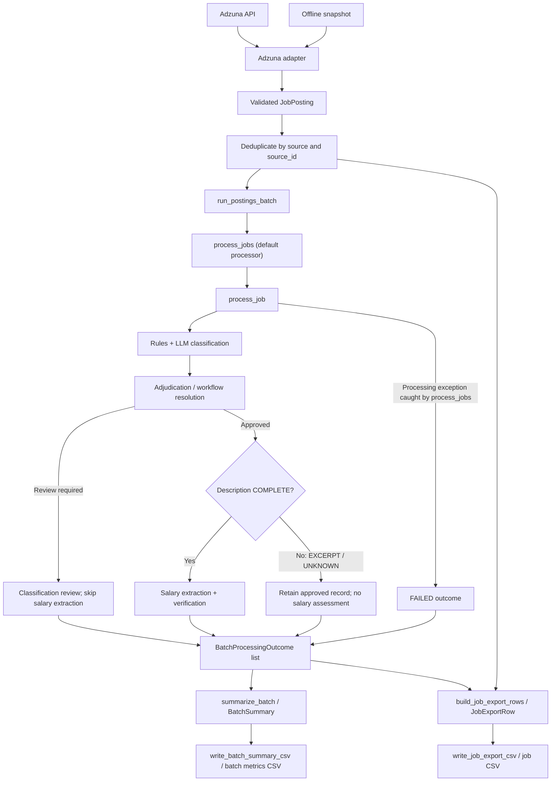

# UK Job Market Agents

A Python project exploring how AI agents, deterministic classification
rules, and data engineering techniques can be used to analyse the UK
data and analytics job market.

The project aims to transform job advertisements into structured,
validated datasets suitable for analysis and visualisation.

## Project Objectives

- Extract structured information from job advertisements.
- Classify roles into data engineering, data science, data analytics,
  and analytics engineering.
- Identify remote, hybrid, and onsite working arrangements.
- Extract and validate advertised salary information.
- Compare deterministic classification rules with LLM predictions.
- Identify classifications requiring further review.
- Produce reliable analytical datasets for downstream reporting.

## Architecture

The project separates responsibilities across several components:

| Component | Responsibility |
| --------- | -------------- |
| Snapshot CLI / processor factory | Parse explicit agent mode, select batch processor, run snapshot workflow and report exit status |
| Pydantic models | Validate structured job advertisement data |
| Adzuna API client | Retrieve provider data with bounded pagination, validation/error handling and injectable transport |
| Ingestion pipeline | Fetch, adapt and deduplicate advertisements by `(source, source_id)` |
| Source adapters | Translate provider-specific advertisements into validated JobPosting objects |
| Classification rules | Apply deterministic role and working-pattern classifications |
| LLM classifier | Interpret job advertisements using a language model |
| LLM salary extractor | Extract structured salary quotations and supporting evidence |
| Salary verification | Check extracted values against evidence and assign review status |
| Evaluation | Compare classification results and measure performance |
| Adjudication | Help resolve disagreements between classification methods |
| Workflow | Coordinate classification results and review decisions |
| Orchestration | Coordinate single-job classification, salary verification and analytical record construction |
| Offline batch integration | Pass prepared postings to an injectable processor and return outcomes with a batch summary |
| Batch orchestration | Process advertisements sequentially, preserve outcomes and isolate failures |
| Batch metrics | Calculate validated processing counts and derived rates |
| Processing policy | Permit salary extraction only for complete descriptions after classification approval |
| Salary policy | Determine eligibility for annual salary analysis |
| Analytics | Construct analytical records and calculate summary metrics |
| CSV export | Serialize analytical results for downstream consumption |
| Job export | Join ordered postings/outcomes into provenance-aware rows, then serialize deterministically |
| Batch reporting | Serialize validated batch metrics into deterministic CSV output |



The diagram shows component relationships. Lesson 27 adds an executable snapshot
CLI around this pipeline; live Adzuna retrieval remains a separate smoke command.
Lesson 22 connects prepared postings to processing through `run_postings_batch()`;
it returns outcomes and `summarize_batch(outcomes)`. Lesson 23 adds the record-level
export boundary; Lesson 24 composes both CSV exports in `run_offline_workflow()`; Lesson 26 adds
`run_snapshot_workflow()` to load and prepare a saved response first. Offline integration tests
use an injected processor; they do not demonstrate a live end-to-end LLM workflow.

## Job Advertisement Ingestion Contract

`JobPosting` provides the canonical internal representation of a job advertisement, independently of the external data provider.

Incoming advertisements must satisfy the following requirements:

- `source` and `source_id` must contain non-whitespace characters.
- `collected_at` must be a timezone-aware datetime.
- `raw_title` and `raw_description` must contain non-whitespace characters.
- `source_url` is optional but must be a valid HTTP/HTTPS URL when supplied.
- `company_name` and `location_raw` remain optional.

Validation rejects blank source fields and advertisement content without stripping or otherwise modifying valid raw strings.

Newly collected advertisements can retain their default `UNKNOWN` classifications and `UNVALIDATED` status until the processing workflows evaluate them.

The model preserves source identity and collection timestamps to support provenance and deduplication.

The Adzuna source adapter, `adapt_adzuna_job()`, translates provider-specific advertisement data into validated `JobPosting` objects. It preserves source identifiers, URLs, raw titles, descriptions, company names and locations where supplied.

`DescriptionCompleteness` distinguishes `COMPLETE`, `EXCERPT` and `UNKNOWN` advertisement descriptions. The Adzuna adapter conservatively marks descriptions as `EXCERPT`; other `JobPosting` instances default to `UNKNOWN`.

`process_job()` preserves source identity, collection timestamps, source URLs and description completeness in `OrchestrationResult`, whether classification succeeds or requires review.

The Adzuna retrieval client and ingestion pipeline support controlled live retrieval and offline snapshot replay (Lesson 21). Lesson 22 adds an offline batch integration helper for prepared postings. Lesson 23 adds a provenance-aware analytical export; persistent ingestion history remains future work.

### Lesson 20 — Adzuna API client and ingestion pipeline

- Implemented the Adzuna API client with bounded pagination and validation/error handling.
- Kept HTTP transport injectable so API behaviour can be tested with mocked transport and deterministic responses.
- Implemented `deduplicate_postings()` using `(source, source_id)`, preserving the first occurrence and first-seen order.
- Implemented `prepare_adzuna_postings()` to adapt raw advertisements into validated `JobPosting` objects and deduplicate them.
- Implemented `ingest_adzuna_jobs()` to coordinate fetching, preparation and deduplication, with injectable `fetch_pages` and transport dependencies.
- Passed the timezone-aware collection timestamp through the pipeline using the keyword-only `collected_at` argument.
- Verified the Lesson 20 pipeline with mocked transport/dependencies; live smoke support follows in Lesson 21.

Adzuna credentials must remain local and must not be committed, including in fixtures, documentation or request logs. Use the existing ignored secrets configuration and verify that credentials are excluded before committing.

**Compatibility:** Introducing timezone-aware collection timestamps required updating existing test fixtures. The full regression suite passed with 190 tests and one expected failure on 22 October 2026.

### Lesson 21 — Controlled Adzuna smoke and snapshot replay

From the repository root, with project dependencies installed in `.venv`:

```bash
# Default: replay the existing local snapshot; no credentials or HTTP calls.
.venv/bin/python -m scripts.smoke_adzuna
# Replay a different snapshot.
.venv/bin/python -m scripts.smoke_adzuna --snapshot data/raw/another_sample.json
# Fetch one UK page for "data engineer", requesting five results, and save it.
.venv/bin/python -m scripts.smoke_adzuna --live
# Choose the destination for a fresh response.
.venv/bin/python -m scripts.smoke_adzuna --live --snapshot data/raw/another_sample.json
```

Live mode requires `ADZUNA_APP_ID` and `ADZUNA_APP_KEY` in the environment;
the script does not load `secrets.json` automatically. Keep values in local
secret storage and inject them into the environment without recording them
in shell history. Never commit credentials or log the constructed request URL:
it contains credentials. The smoke script suppresses request exception details,
reporting only an HTTP status or a generic request failure.

The default snapshot is `data/raw/adzuna_sample.json`. Both `data/raw/` and
`secrets.json` are ignored and must remain untracked. A fresh checkout has no
snapshot: obtain one locally before replay. Custom paths outside `data/raw/`
are not covered by that ignore rule and must also stay out of commits.

Both modes adapt and deduplicate the response and print retrieved/validated
counts. The existing local snapshot replay produced **5 retrieved / 5 unique
validated postings** on 27 October 2026; no fresh live request was made during
this close-out.

The adapter now preserves publication time, paired coordinates, raw contract
and category metadata, and provider salary bounds/prediction status. Coordinates
must be in range and supplied together; publication times must be timezone-aware.
Provider salary bounds are non-negative and ordered, and remain separate from
interpreted salary fields. Prediction flags accept only `"0"`, `"1"` or `None`;
empty optional contract/category text becomes `None`.

**Testing:** `tests/test_smoke_adzuna.py` creates a synthetic temporary snapshot,
removes both credentials and replaces HTTP transport with a function that fails
if called. This guards the offline default without depending on a live API or
committed provider data. Run focused tests before the full suite:

```bash
.venv/bin/python -m pytest -q tests/test_smoke_adzuna.py tests/ingestion tests/test_job_posting.py
.venv/bin/python -m pytest -q -ra
```

**Caveats:** `--live` overwrites the chosen snapshot before adapting its adverts.
Replay assigns the current UTC time to `collected_at`, not the original fetch
time; the snapshot does not store that timestamp. Malformed JSON or an invalid
advert can stop the smoke run. Descriptions remain excerpts and predicted
salaries are provider metadata, not verified advertised salaries. This small
sample validates ingestion, not market coverage or end-to-end LLM processing.

### Lesson 22 — Offline batch integration

`src/uk_job_market_agents/ingestion/batch_integration.py` adds
`run_postings_batch(postings, *, processor=process_jobs)`, returning processing
outcomes together with `summarize_batch(outcomes)`. The default processor reuses
the existing batch and single-job orchestration; tests can inject a processor
without invoking live LLM services. Adaptation and deduplication remain upstream
responsibilities, handled for Adzuna payloads by `prepare_adzuna_postings()`.

Four tests in `tests/ingestion/test_batch_integration.py` cover populated and empty
batches, mixed outcomes, and synthetic Adzuna payloads prepared through
`prepare_adzuna_postings()`, including provenance and deduplication. This verifies
the offline integration boundary, not live end-to-end LLM behaviour. The duplicate
import in `tests/analytics/test_batch_summary.py` was also removed.

**State (verified 30 October 2026):** Committed at `9a672ee` on
`lesson/22-offline-batch-integration`. Lesson 21 commit:
`28fd5dc`. Batch metrics CSV export is available separately; no executable CLI
currently connects retrieval, processing and every export component.

## Lesson 23 — Provenance-aware job export

Agents/LLMs interpret advertisements; deterministic Python/Pydantic validates,
selects and serializes values. `build_job_export_rows(postings, outcomes)` in
`analytics/job_export.py` pairs the two ordered lists with strict length checking
and requires each `posting.source_id == outcome.job_id`. It preserves input order,
including failed and review-required advertisements. It neither sorts nor deduplicates.

Provenance and provider metadata always come from the original posting, even when
processing failed: source, source ID, timezone-aware collection time, description
completeness, company name and provider salary fields.

| Processing status | Exported analytical fields |
| --- | --- |
| `processed` | Role, work pattern and salary bounds from the analytical record, when present |
| `review_required` | Empty role, work pattern and analytical salary fields; classification review reason retained |
| `failed` | Empty analytical fields and review reason; source metadata retained |

Processing status describes classification/processing, not salary verification.
`salary_min` and `salary_max` copy the upstream analytical record. In the normal
`process_job()` path, only verified, complete GBP annual ranges qualify; daily,
hourly, incomplete, undisclosed or unverified salaries leave these fields empty.
The exporter does not reverify salary evidence. `source_salary_min/max` remain
provider values; `source_salary_predicted` distinguishes true, false and unknown.
Even a false prediction flag does not establish verified advertised salary.
Provider values never fill missing analytical salary bounds.

### CSV contract and offline usage

`write_job_export_csv(rows, output_path: Path)` in `analytics/job_export_csv.py`
writes this fixed 14-column schema:

```csv
source,source_id,collected_at,description_completeness,processing_status,role_family,work_pattern,salary_min,salary_max,source_salary_min,source_salary_max,source_salary_predicted,classification_review_reason,company_name
```

Identical ordered rows produce identical bytes in the same runtime: UTF-8 without
a BOM, LF record terminators and a final newline. Empty input writes the header.
Pydantic JSON serialization supplies enum values and ISO timestamps (UTC uses
`Z`; other timezone offsets are preserved). Missing values become empty fields;
booleans become `True`/`False`. Numeric values use ordinary Python CSV conversion
(no fixed decimal precision). Standard CSV quoting preserves commas, quotes and
embedded newlines; embedded source text is not normalized.

This complete example uses a synthetic failure and makes no API or LLM calls:

```python
from datetime import datetime, timezone
from pathlib import Path

from uk_job_market_agents.agents.batch_orchestration import (
    BatchProcessingOutcome, ProcessingStatus,
)
from uk_job_market_agents.analytics.job_export import build_job_export_rows
from uk_job_market_agents.analytics.job_export_csv import write_job_export_csv
from uk_job_market_agents.models.job_posting import JobPosting

postings = [JobPosting(
    source="fixture", source_id="001",
    raw_title="Data Engineer", raw_description="Synthetic offline example",
    collected_at=datetime(2026, 10, 30, tzinfo=timezone.utc),
)]
outcomes = [BatchProcessingOutcome(
    job_id="001", status=ProcessingStatus.FAILED,
    error="Synthetic failure for export demonstration",
)]
rows = build_job_export_rows(postings, outcomes)
write_job_export_csv(rows, Path("job_export.csv"))
```

For existing batch results, pass the same prepared postings and their returned
outcomes. The default batch processor invokes LLM workflows; use precomputed
outcomes or an injected offline processor when working offline.

**Limitations:** Pairing is positional and checks only source ID: outcomes lack a
required source-qualified identity, so cross-provider ID collisions cannot be
fully detected. Use outcomes from the same ordered batch. `JobExportRow` is a
typed serialization model, not an independent workflow/salary verifier; manually
constructed records can bypass upstream policies. A processed outcome with no
analytical record exports empty analytical fields. Excerpts remain explicitly
labelled and do not imply complete advertisement evidence. This selected schema
omits source URL, raw text, title/location, salary evidence/review status and
failure details; retain original postings/outcomes and the separate salary audit
export when those are needed. The writer overwrites an existing file, requires
an existing parent directory and does not write atomically. No CLI, persistence
or new live processing is introduced.

## Salary Validation and Analytical Records

Salary processing separates data validation, analytical eligibility,
and classification approval.

### SalaryQuote

`SalaryQuote` is a Pydantic model that validates salary information.

It ensures that:

- At least one salary bound is provided.
- Salary bounds are positive integers.
- Minimum salaries do not exceed maximum salaries.
- The payment period is recognised: year, day, or hour.
- The currency is GBP.

A valid salary quotation is not necessarily eligible for annual
salary comparisons.

### annual_salary_bounds()

`annual_salary_bounds()` determines whether a validated salary
quotation is eligible for annual salary analysis.

Only complete annual salary ranges are eligible.

Daily rates, hourly rates, incomplete annual ranges, and missing
salary quotations return `(None, None)`.

This prevents salaries expressed in incompatible payment periods
from being compared without an explicit conversion policy.

### build_analytical_record()

`build_analytical_record()` constructs an `AnalyticalJobRecord`
from an approved classification and its associated salary quotation.

The function:

- Accepts optional `company_name` and `location_raw` parameters,
  preserving the advertised employer and location. `process_job()`
  supplies these fields from the `JobPosting`.
- Returns `None` when classification review is required.
- Returns `None` when no resolved classification is available.
- Retains approved advertisements without eligible annual salaries.
- Populates annual salary fields using `annual_salary_bounds()`.

For example, an approved Data Engineer advertisement offering
£500–£600 per day remains eligible for role-family and working-pattern
analysis, even though its annual salary fields are empty.

## Salary extraction and analytical eligibility

The system uses structured LLM output to identify salary information and supporting evidence.
Deterministic verification assigns a review status before the extracted salary is considered for analytics.
All salary assessments can be exported to an auditable CSV, including those requiring review or containing no disclosed salary.
Only verified GBP annual salary ranges with both bounds present are eligible for annual salary statistics.
Daily and hourly rates are not annualised. Ineligible salaries are excluded from salary calculations without
removing their associated advertisements from job counts.

The single-job orchestrator `process_job()` applies the salary integration
adapter after salary extraction and verification. This path is covered by
orchestration tests. Lesson 22 connects prepared postings to batch processing
through an injectable helper; live end-to-end LLM processing remains unverified.

## Orchestration

`process_job(job: JobPosting) -> OrchestrationResult` coordinates the
single-job classification and salary workflows.

The orchestrator:

- Classifies the raw title and description, then resolves the classification.
- Builds an analytical record, preserving `company_name` and `location_raw`.
- Stops before salary extraction if classification review is required or no
  resolved classification is available.
- For an approved advertisement with a `COMPLETE` description, extracts and
  verifies salary information, then applies the salary assessment to the record.
- Skips salary extraction for `EXCERPT` and `UNKNOWN` descriptions while
  retaining approved analytical records with empty salary fields.
- Retains the approved advertisement when salary review is required, salary
  is not disclosed, or the quotation is ineligible for annual analysis.
  Annual salary fields remain empty in these cases.

`OrchestrationResult` contains `classification` (`WorkflowResolution`),
`analytical_record` (`AnalyticalJobRecord` or `None`) and
`salary_assessment` (`SalaryAssessment` or `None`). When classification
prevents record construction, both optional fields are `None`.

Only verified, complete GBP annual salary ranges populate annual salary
fields. Classification review and salary review therefore have distinct
consequences: the former prevents an analytical record; the latter does
not remove an otherwise approved advertisement from job counts.

The single-job orchestrator is reused by the batch-processing workflow
described below.

## Batch Orchestration

The batch orchestration workflow processes multiple job advertisements
sequentially using the existing `process_job()` function.

`process_jobs()` returns a list of `BatchProcessingOutcome` objects,
preserving advertisement identifiers and input order.

Each outcome has one of three statuses:

- `PROCESSED`: Classification completed without requiring review.
- `REVIEW_REQUIRED`: Classification completed but requires review.
- `FAILED`: Processing raised an exception.

Pydantic model validators enforce consistency between processing status,
classification decisions, orchestration results, and error messages.

Individual processing failures are isolated so subsequent advertisements
can continue processing.

The current implementation is sequential and does not support
concurrency, retries, or persistent processing history.

## Batch Operational Metrics

`BatchSummary` provides deterministic aggregate statistics derived
from validated `BatchProcessingOutcome` objects.

The `summarize_batch()` function calculates:

- Total advertisements processed in the batch.
- Advertisements successfully processed.
- Advertisements requiring classification review.
- Advertisements that failed during processing.

`BatchSummary` also exposes three calculated proportions:

- `processed_rate`
- `review_rate`
- `failure_rate`

Rates range from 0.0 to 1.0. Empty batches return zero counts and
zero rates, avoiding division-by-zero errors.

Pydantic validation enforces non-negative counts and requires the
individual status counts to sum to the batch total.

Batch aggregation is deterministic and does not invoke an LLM.

The calculated rates are Python properties and are not currently
included in Pydantic's standard `model_dump()` output.

### Batch Metrics CSV Export

`write_batch_summary_csv()` serializes a validated `BatchSummary`
into a deterministic, single-row CSV report.

The export uses this fixed column order:

```csv
total,processed,review_required,failed,processed_rate,review_rate,failure_rate
```

Processing, review and failure rates are represented as proportions
between 0 and 1, formatted to six decimal places.
The exporter guarantees:

- A stable seven-column schema.
- Exactly one data row per summary.
- LF (`\n`) line endings and a final newline.
- Zero counts and zero rates for empty batches.
- Identical output for identical input summaries.

Serialization is separate from aggregation and does not invoke an LLM.
The exporter accepts a writable text stream, allowing output to
in-memory buffers or files.

## CSV Export Contract

`write_salary_analysis_csv` accepts a sequence of `SalaryAnalysisRow`
instances and writes aggregated salary-analysis results to a CSV file.

The exporter guarantees:

- **Column schema:** The following six columns are written in the specified order:

  ```csv
  dimension,segment,records,records_with_salary,average_midpoint,has_sufficient_sample
  ```

- **Deterministic output:** Identical input rows, supplied in the same order,
  produce identical CSV bytes. The exporter does not automatically sort rows.
- **Line endings:** The exporter uses LF (`\n`) line endings, regardless of
  operating system.
- **Missing values:** An unavailable `average_midpoint` is represented by
  an empty CSV field.

The export contains aggregated salary-analysis summaries rather than
individual job advertisements.

### Salary extraction CSV

`write_salary_extraction_csv()` exports individual salary assessments,
including verified, review-required, and not-disclosed results.

The export contains eight columns:

```csv
job_id,salary_min,salary_max,period,currency,evidence,review_status,review_reason
```

The exporter preserves input order, uses LF line endings, and represents
missing values as empty fields. Identical ordered inputs produce identical
CSV bytes.

This record-level audit export is separate from the aggregated salary
analysis CSV.

## Testing

The project uses pytest to validate model contracts, classification
behaviour, analytical policies, and workflow decisions.

Run the complete test suite:

```bash
python -m pytest -q
```

**Lesson 23 validation (30 October 2026):** **15 focused tests passed in 0.40s**;
full suite **259 passed, 2 skipped, 1 xfailed in 0.43s**. Credentials were removed
from the test environment; the two live OpenAI integration tests skipped.
The expected failure remains the remote-first / mandatory office-attendance rule.
No live API or LLM calls were made.

```bash
env -u OPENAI_API_KEY -u ADZUNA_APP_ID -u ADZUNA_APP_KEY .venv/bin/python -m pytest -q tests/analytics/test_job_export.py tests/analytics/test_job_export_csv.py
env -u OPENAI_API_KEY -u ADZUNA_APP_ID -u ADZUNA_APP_KEY .venv/bin/python -m pytest -q -ra
```

Current branch: `lesson/30-analysis-ready-dataset` (verified 9 November 2026).
Lesson 29 is committed at `4315400`. Lesson 30 implementation and tests remain
untracked; this review updates documentation without staging or committing.
See Lesson 30 below for fresh offline validation.

## Lesson 24 — End-to-End Offline Workflow

`ingestion/offline_workflow.py` exposes
`run_offline_workflow(postings, *, processor, job_export_path, summary_export_path)`.
It accepts prepared `list[JobPosting]` values and returns `(outcomes, summary)`.
The processor is required: pass an offline fixture or deterministic processor.
The helper itself does not fetch advertisements or invoke an LLM; it cannot
prevent a caller-supplied processor from using the network.

The flow reuses `run_postings_batch()` → `build_job_export_rows()` →
`write_job_export_csv()` and `write_batch_summary_csv()`. Pairing is validated
before opening either output. Summary files use UTF-8 and `newline=""` so the
existing LF and six-decimal rate contract is preserved. Adaptation and
deduplication stay upstream. No new salary or provenance rules are introduced:
excerpts remain labelled, provider salaries never fill verified salary fields,
and only processed outcomes contribute approved analytics.

Runnable synthetic example (from the repository root with the virtual environment):

```bash
PYTHONPATH=src .venv/bin/python - <<'PYTHON'
from datetime import datetime, timezone
from pathlib import Path
from uk_job_market_agents.agents.batch_orchestration import BatchProcessingOutcome, ProcessingStatus
from uk_job_market_agents.ingestion.offline_workflow import run_offline_workflow
from uk_job_market_agents.models.job_posting import JobPosting

postings = [JobPosting(
    source="fixture", source_id="example-1", raw_title="Data Engineer",
    raw_description="Python and SQL",
    collected_at=datetime(2026, 10, 30, tzinfo=timezone.utc),
)]

def offline_processor(jobs):
    return [BatchProcessingOutcome(
        job_id=job.source_id, status=ProcessingStatus.FAILED,
        error="Synthetic offline example; no model processing attempted",
    ) for job in jobs]

outcomes, summary = run_offline_workflow(
    postings, processor=offline_processor,
    job_export_path=Path("offline_jobs.csv"),
    summary_export_path=Path("offline_summary.csv"),
)
print(summary)
PYTHON
```

**File contract and limitations:** Use distinct `Path` destinations with existing
parent directories. Same resolved paths and existing symlink/hard-link aliases
are rejected before the processor runs. Existing outputs are overwritten.
Processor and pairing failures propagate before writing; I/O failures propagate
without rollback. The two writes are not atomic: a summary write failure can
leave a completed jobs export. No CLI, fetching, retries, persistence or new
validation framework is added. This is an offline integration boundary, not
proof of live processing or salary verification.

**Validation (30 October 2026):** 12 new workflow cases; combined focused tests
**35 passed in 0.23s**; full suite **271 passed, 2 skipped, 1 xfailed in 0.46s**.
Credentials were removed; live OpenAI tests skipped. New workflow tests block
socket connections and cover empty/mixed batches, Unicode provenance, separate
provider/analytical salaries (including missing verified salaries), suppression
of review-required analytics, deterministic bytes, mismatches without file
changes, and colliding destinations. The known classification-rule xfail remains.
The supplied baseline of 261 passed includes the two tests skipped here;
259 offline passes plus 12 new cases yields 271.

```bash
env -u OPENAI_API_KEY -u ADZUNA_APP_ID -u ADZUNA_APP_KEY .venv/bin/python -m pytest -q tests/ingestion/test_offline_workflow.py tests/ingestion/test_batch_integration.py tests/analytics/test_job_export.py tests/analytics/test_job_export_csv.py tests/analytics/test_batch_output.py
env -u OPENAI_API_KEY -u ADZUNA_APP_ID -u ADZUNA_APP_KEY .venv/bin/python -m pytest -q -ra
```

## Lesson 25 — Description-completeness processing policy

`ingestion/processing_policy.py` defines the deterministic predicate
`should_attempt_salary_extraction()`. `process_job()` applies it only after
classification permits an analytical record:

| Description completeness | Salary processing for an approved job |
| --- | --- |
| `COMPLETE` | Attempt extraction and verification; apply the existing analytical eligibility rules |
| `EXCERPT` | Skip extraction; retain the analytical record with empty salary bounds |
| `UNKNOWN` | Skip extraction; retain the analytical record with empty salary bounds |

In the normal orchestration path, `salary_assessment=None` means extraction was
**not attempted**, either because classification prevented record construction
or because description completeness excluded it. `NOT_DISCLOSED` is an actual
assessment after extraction was attempted and returned neither salary nor
evidence. A skipped excerpt must not be counted as an advertisement with no
salary disclosed. `COMPLETE` permits an attempt; it does not guarantee a verified
salary. Verification and complete annual GBP range eligibility still apply.

Exports preserve `source_salary_min`, `source_salary_max` and
`source_salary_predicted` from the original posting separately from analytical
`salary_min` / `salary_max`. For example, an approved excerpt with predicted
provider bounds of £40,000–£60,000 retains those provider fields and its
`processed` status, but has empty analytical salary bounds. Provider values
never substitute for verified salary, even when the prediction flag is false.
The existing 14-column job CSV does not include salary assessment status; retain
orchestration results to distinguish skipped extraction from `NOT_DISCLOSED`.

**Design and trade-off:** Completeness is explicit source metadata, not an LLM
judgement or a text-length heuristic. Adzuna descriptions remain `EXCERPT` and
other postings default to `UNKNOWN`; neither is silently promoted to `COMPLETE`.
This conservative gate prioritises evidence quality over salary coverage: it
also excludes usable salary text that might appear in an excerpt. Approved jobs
remain available for role/work-pattern counts, but salary statistics cover a
smaller, potentially unrepresentative subset. Missing salary bounds alone do
not measure salary non-disclosure. The gate is enforced in `process_job()`, not
in the exporter or direct calls to the salary workflow; injected processors
remain responsible for their own behavior. No schema or classification policy
change is introduced.

**Tests:** Three parameterised policy cases cover every completeness value;
two orchestration cases assert that excerpt/unknown jobs never call the salary
workflow and retain records/provenance with empty salaries. Existing complete
fixtures exercise attempted extraction, verified salaries and unverified
salary exclusion. An export regression carries an excerpt through mocked
classification and `process_job()` to prove provider predictions survive
without becoming analytical salary. These tests use mocks, not live LLM calls.

```bash
env -u OPENAI_API_KEY -u ADZUNA_APP_ID -u ADZUNA_APP_KEY .venv/bin/python -m pytest -q tests/ingestion/test_processing_policy.py tests/agents/test_orchestration.py tests/analytics/test_job_export.py tests/analytics/test_job_export_csv.py tests/agents/test_salary_review.py tests/analytics/test_salary_integration.py
env -u OPENAI_API_KEY -u ADZUNA_APP_ID -u ADZUNA_APP_KEY .venv/bin/python -m pytest -q -ra
```

**Validation (2 November 2026):** **40 focused tests passed in 0.29s**; full offline suite
**277 passed, 2 skipped, 1 xfailed in 0.45s**. `git diff --check` is clean.
The skips are the two credential-dependent OpenAI integration tests; the
expected failure is the known remote-first / mandatory office-attendance rule.

The supplied checkpoint was 279 passed, 1 xfailed. Removing API credentials
for this rerun accounts for two live tests moving from passed to skipped.

**Follow-on:** Lesson 26 adds the snapshot-backed Python API below.
Live processing, persistence and additional audit columns remain deferred.

## Lesson 26 — Snapshot-backed offline execution

`run_snapshot_workflow(snapshot_path, *, collected_at, processor,
job_export_path, summary_export_path)` loads a saved Adzuna response, prepares
unique postings, and reuses Lesson 24 processing and CSV exports. It returns
`(list[BatchProcessingOutcome], BatchSummary)`. This is a Python API, not a CLI.

- `load_adzuna_snapshot(Path)` reads UTF-8 JSON and requires a top-level object
  with a `results` list containing only objects; an empty list is valid.
  Structural failures raise `ValueError`; malformed JSON raises
  `JSONDecodeError`, and file errors propagate. Advertisement-field validation
  happens later in the existing adapter / `JobPosting` model.
- `prepare_adzuna_snapshot(Path, *, collected_at)` reuses
  `prepare_adzuna_postings()`: adapt every advert, then deduplicate by
  `(source, source_id)`, retaining the first occurrence and first-seen order.
  Invalid adverts stop preparation; they are not silently skipped.
- Supply an explicit timezone-aware `collected_at`, validated when postings are
  built. It is not inferred from the file, publication date or current clock;
  use a known capture time if available, otherwise document your replay-time
  convention. Empty snapshots build no postings, so do not validate the timestamp.
- The required processor receives the prepared list and must return one outcome
  per posting in the same order with matching `job_id`. Supply a network-free
  processor for offline use: neither helper prevents injected code from making
  network calls, and `process_jobs` normally invokes LLM services.

Run this synthetic example from the repository root; it creates temporary input
and output files and demonstrates export with deliberately failed outcomes:

```bash
PYTHONPATH=src .venv/bin/python - <<'PYTHON'
import json
from datetime import datetime, timezone
from pathlib import Path
from tempfile import TemporaryDirectory
from uk_job_market_agents.agents.batch_orchestration import BatchProcessingOutcome, ProcessingStatus
from uk_job_market_agents.ingestion.snapshot_execution import run_snapshot_workflow

def offline_processor(postings):
    return [BatchProcessingOutcome(
        job_id=p.source_id, status=ProcessingStatus.FAILED,
        error="Synthetic example; no model processing attempted",
    ) for p in postings]

with TemporaryDirectory() as directory:
    root = Path(directory)
    snapshot = root / "snapshot.json"
    snapshot.write_text(json.dumps({"results": [{
        "id": "example-26", "title": "Data Engineer",
        "description": "Python and SQL excerpt",
        "salary_min": 40000, "salary_max": 60000,
        "salary_is_predicted": "1",
    }]}), encoding="utf-8")
    outcomes, summary = run_snapshot_workflow(
        snapshot,
        collected_at=datetime(2026, 11, 3, tzinfo=timezone.utc),
        processor=offline_processor,
        job_export_path=root / "jobs.csv",
        summary_export_path=root / "summary.csv",
    )
    print(summary)
    print((root / "jobs.csv").read_text(encoding="utf-8"))
    print((root / "summary.csv").read_text(encoding="utf-8"))
PYTHON
```

For a saved response, pass its local `Path` and distinct output paths with existing
parents. Existing files are overwritten; the two writes are not atomic. The job
CSV uses the existing 14-column contract; summary CSV contains batch counts and
rates. Empty results with an empty processor result produce a header-only job
CSV and a zero-count summary. See Lesson 24 for pairing/path checks and failure
behavior, and Lesson 21 for keeping local snapshots out of Git.

Original posting identity, collection time, excerpt label, company and provider
salary metadata survive export even for failures. Adzuna descriptions remain
`EXCERPT`: normal `process_job()` skips salary extraction for them while retaining
approved classification records. Provider `source_salary_*` values are separate
from verified analytical salary bounds and never fill them; `processed` does not
mean salary verified. Injected processors must uphold their own processing policy.

```bash
.venv/bin/python -m pytest -q tests/ingestion/test_snapshot_loader.py tests/ingestion/test_snapshot_pipeline.py tests/ingestion/test_snapshot_execution.py
env -u OPENAI_API_KEY -u ADZUNA_APP_ID -u ADZUNA_APP_KEY .venv/bin/python -m pytest -q -ra
git diff --check
```

**Validation (3 November 2026):** 16 snapshot tests passed; the execution tests
block socket connections. Full offline rerun: 293 passed, 2 credential-dependent
OpenAI tests skipped, 1 known xfailed. The user-verified full run was 295 passed,
1 xfailed in 7.81s; the two skipped live tests explain the difference.

## Lesson 27 — Snapshot CLI with explicit agent processing

The entry point is `python -m uk_job_market_agents`: `__main__.py` exits with
`cli.main()`'s status. The CLI parses arguments, selects `process_jobs` through
`processing/processor_factory.py`, and calls `run_snapshot_workflow()`.
That reuses loading, adaptation/deduplication, sequential job orchestration,
summary calculation and both CSV writers. The CLI prints Total, Processed,
Review required and Failed counts after successful export.

**Saved input does not mean network-free processing.** The only CLI mode is
explicit `--mode agent`; there is no default, dry-run or rules-only mode.
It warns on stderr that processing may incur API costs, without a confirmation
prompt. Python callers can inject `main(argv, processor=...)` for offline tests;
the parser still requires mode, but injection bypasses factory selection and
the credential check and cost warning. Injection does not enforce network isolation.

### Usage and argument contract

From the repository root, with project dependencies installed in `.venv`:

```bash
PYTHONPATH=src .venv/bin/python -m uk_job_market_agents --help
```

The following processes an existing local snapshot using the live LLM path.
First configure credentials as described below and choose the correct collection
time; the timestamp shown is an example, not a claim about the snapshot's capture.
The output parent must already exist (this example creates it):

```bash
mkdir -p data/raw/lesson27
PYTHONPATH=src .venv/bin/python -m uk_job_market_agents \
  --snapshot data/raw/adzuna_sample.json \
  --collected-at 2026-11-04T09:00:00+00:00 \
  --jobs-out data/raw/lesson27/jobs.csv \
  --summary-out data/raw/lesson27/summary.csv \
  --mode agent
```

This command was not run against live services during documentation close-out.
`data/raw/` is ignored; a fresh checkout does not include the input snapshot.

| Argument | Contract |
| --- | --- |
| `--snapshot` | Required path to UTF-8 JSON: a top-level object with a `results` list of objects. Each advert must pass adapter/model validation. |
| `--collected-at` | Required timezone-aware ISO timestamp parsed by `datetime.fromisoformat`; use an explicit offset such as `+00:00` for Python 3.10 compatibility. Naive timestamps are rejected, even for empty input. |
| `--jobs-out` | Required job CSV path; parent must exist. |
| `--summary-out` | Required summary CSV path; parent must exist and destination must differ from jobs output, including existing file aliases. |
| `--mode agent` | Required; `agent` is the only accepted value and selects the real LLM batch processor. |
| `-h`, `--help` | Display help and exit without processing. |

Paths are relative to the current directory unless absolute. Input is adapted
before first-seen deduplication by `(source, source_id)`; an invalid advert
aborts preparation rather than becoming an individual failed outcome. Empty
`results` is valid and produces a header-only jobs CSV and a zero-count summary,
with no model calls.

### Credentials, costs and failure visibility

Classification, adjudication and salary extraction construct `OpenAI()`
directly. The normal credential path is `OPENAI_API_KEY` in the process
environment. Neither the CLI nor these clients loads `secrets.json` or a
`.env` file. Keep credentials in local secret storage and inject them without
putting their values in commands, logs or version control. Adzuna credentials
are not needed to process a saved response.

The installed SDK also reads environment configuration such as
`OPENAI_ORG_ID`, `OPENAI_PROJECT_ID` and `OPENAI_BASE_URL`; review these before
a live run. It recognizes `OPENAI_ADMIN_KEY` too, but that is not a substitute
for configuring the normal inference key. The application does not expose
credential, endpoint, model, timeout or retry flags. All three agent modules
currently hard-code `gpt-5.6-luna`; availability/access was not verified live.

Each valid unique posting attempts LLM classification; disagreements can trigger
separate role and work-pattern adjudication calls. Adzuna descriptions remain
`EXCERPT`, so normal orchestration skips salary extraction even when approved.
There is no CLI spending cap or job limit. SDK retries may occur even though the
application has no batch retry policy. Costs depend on calls and tokens; no
fixed cost estimate or live pricing claim is made here.

**Missing credentials fail fast.** Without an injected processor, agent mode
requires a non-empty `OPENAI_API_KEY` before processor selection or snapshot
execution. A missing key prints an error and exits 2 without processing or
exports. This checks presence only, not key validity. Invalid credentials,
unavailable models or service failures can still produce failed job outcomes.
Their error details remain in `BatchProcessingOutcome.error`; neither CSV nor
the CLI summary includes those details. Python workflow callers can retain
outcomes for diagnostics. An empty run does not validate credentials.

| Exit code | Meaning |
| --- | --- |
| `0` | Exports completed with no failed jobs, including empty or review-only batches; also successful help. It does not imply every job was approved or salary-verified. |
| `1` | Exports completed but at least one job failed, possibly all jobs. |
| `2` | Argument parsing error, missing agent credentials, colliding resolved input/output paths, or a workflow `OSError` / `ValueError` (including malformed JSON and model validation). Parser errors show usage; handled workflow errors print `Execution error: ...` to stderr without a traceback. |

These codes cover handled paths. Unexpected exceptions outside that catch can
still propagate with a traceback; processor selection occurs before the catch.
The snapshot loader rejects missing `id`, `title` or `description` with a
`ValueError` naming the zero-based result index and missing fields. The CLI
returns 2 without a traceback, processing or exports, even if earlier adverts
were valid. Present fields still pass through existing adapter/model validation;
this is not comprehensive validation of every malformed optional field type.

### Export and snapshot limitations

The jobs export retains the existing 14-column selected-provenance schema;
summary CSV has total/processed/review_required/failed and three rates.
Existing destinations are overwritten, jobs first and summary second, without
atomic publication. A later write failure can leave a completed jobs file or
partial output; output-parent checks happen at write time, potentially after
paid processing. The CLI rejects resolved-path collisions among input and both
outputs before processor selection, including symlinks. The workflow additionally
rejects output-to-output hard links. Input-to-output hard links are not detected;
keep these distinct too.

The supplied collection time is preserved; original capture time cannot be
recovered from this response format. Excerpts are not full advert evidence.
Provider salary bounds/prediction flags never fill analytical salary fields,
and empty analytical salaries do not establish non-disclosure. Failure details,
raw advert text and salary assessments are not included in the jobs CSV.
Live ingestion, persistent history, concurrency and end-to-end live validation
remain outside this lesson.

### Verification (4 November 2026)

Latest offline close-out: **46 focused passed in 0.58s**; full suite
**323 passed, 2 skipped, 1 xfailed in 0.72s**. The two credential-dependent
live tests were skipped; the existing remote-first/mandatory-office rule remains
xfailed. Socket connections were
blocked and API credentials removed during both runs; no live calls were made.
Three new regression cases cover missing `id`, `title` and `description` after
a valid advert, asserting exit 2, precise stderr, no processor call, no exports
and unchanged input. Two factory/warning unit tests now set a dummy key locally
to exercise their intended paths independently of the user's credentials.
Existing credential and collision tests pass. Both staged and unstaged diff
whitespace checks pass; existing staged content was preserved.

```bash
env -u OPENAI_API_KEY -u OPENAI_ADMIN_KEY -u ADZUNA_APP_ID -u ADZUNA_APP_KEY .venv/bin/python -m pytest -q tests/test_cli.py tests/test_cli_entrypoint.py tests/test_cli_integration.py tests/test_processor_factory.py tests/ingestion/test_snapshot_loader.py tests/ingestion/test_snapshot_pipeline.py tests/ingestion/test_snapshot_execution.py
env -u OPENAI_API_KEY -u OPENAI_ADMIN_KEY -u ADZUNA_APP_ID -u ADZUNA_APP_KEY .venv/bin/python -m pytest -q -ra
git diff --check
git diff --cached --check
```

## Lesson 29 — Deterministic data quality evaluation

`analytics/data_quality.py` provides
`summarize_data_quality(rows: Sequence[JobExportRow]) -> DataQualitySummary`.
It calculates coverage from typed export rows without LLM calls, CSV parsing,
network access or interpretation of advertisement content. CSV loading and
conversion of empty cells to `None` belong upstream of metric calculation.

Every metric stores `populated` (numerator), `total` (denominator: all input
rows, including review/failed rows) and `rate` (`populated / total`). Empty
input returns zero counts and `rate=None` (JSON `null`): coverage is undefined,
not zero. This differs from the existing empty-batch operational rates.

| Metric | Row counts as populated when | User-verified Lesson 28 CSV: populated / total | Rate |
| --- | --- | --- | --- |
| `company_coverage` | `company_name` contains non-whitespace characters | 5/5 | 1.0 |
| `approved_role_coverage` | `role_family` is not `None` | 4/5 | 0.8 |
| `known_work_pattern_coverage` | `work_pattern` is `REMOTE`, `HYBRID` or `ONSITE`; `UNKNOWN` and `None` are excluded | 3/5 | 0.6 |
| `provider_salary_coverage` | Both `source_salary_min` and `source_salary_max` are not `None` | 5/5 | 1.0 |
| `verified_salary_coverage` | Both analytical `salary_min` and `salary_max` are not `None` | 0/5 | 0.0 |
| `complete_description_coverage` | `description_completeness` is `COMPLETE` | 0/5 | 0.0 |

**Pydantic invariants:** `CoverageMetric` requires non-negative counts,
`populated <= total`, and a supplied numeric rate between 0 and 1. For a positive
denominator, the rate must be present and equal `populated / total` within
`1e-9`; for a zero denominator, it must be `None`. `DataQualitySummary.total`
is non-negative and every metric denominator must equal that summary total.

**Validation (user-verified, 6 November 2026):** **7 focused passed**;
full suite **332 passed, 1 known xfailed in 5.82s**. The expected failure is
the remote-first / mandatory office-attendance classification-rule case.
`tests/analytics/test_data_quality.py` covers the five-row characteristics,
empty input, missing/partial fields, UNKNOWN exclusion, invalid counts/rates,
rate consistency and summary denominator consistency. The live Lesson 28
five-row CSV produced the coverage values above. These are supplied results;
application tests and live processing were not rerun for this documentation update.

```bash
python -m pytest tests/analytics/test_data_quality.py -v
python -m pytest -q -ra
git diff --check
```

**Limitations:** Coverage is not accuracy, correctness or representativeness.
This small sample is concentrated in Northern Ireland and cannot characterise
the wider UK job market. The function trusts existing fields: approved-role
coverage does not recheck approval, and verified-salary coverage does not
reverify salary evidence. Those meanings depend on the upstream export and
processing contracts; manually constructed rows do not prove either. Provider
coverage includes predicted values and never supplies a verified-salary fallback.
Both salary bounds are required; one populated bound does not count. Complete
description coverage trusts the label without inspecting text. Empty analytical
salary fields do not establish non-disclosure: all five descriptions are excerpts,
so the normal processing policy skips salary extraction. This lesson adds no
CLI integration, CSV reader/writer or new processing policy.

## Lesson 30 — Analysis-ready dataset selection

`analytics/analytical_dataset.py` filters a `Sequence[JobExportRow]` and reports
sample sizes using deterministic Python. LLM interpretation, classification
approval and salary evidence verification remain upstream; these helpers do
not call agents, read CSVs, fetch data or write exports.

| Helper | Eligibility / result |
| --- | --- |
| `select_role_eligible_rows(rows)` | `processing_status == ProcessingStatus.PROCESSED` and `role_family is not None` |
| `select_salary_eligible_rows(rows)` | `processing_status == ProcessingStatus.PROCESSED` and both analytical `salary_min` and `salary_max` are not `None` |
| `summarize_analytical_samples(rows)` | `AnalyticalSampleSummary` with `total`, `role_eligible` and `salary_eligible` |

The selectors return new lists in input order without mutating the input.
They retain the original row objects, rather than making copies, and do not
deduplicate: repeated rows count repeatedly. Role and salary samples are
independent, potentially overlapping subsets, not a partition. Salary selection
does not require a role; role selection does not require salary or a known work
pattern. Neither selector adds a description-completeness check.

Each eligibility metric reuses `CoverageMetric`: `populated` is the selected
count, `total` is **all supplied rows**, including failed, review-required and
missing-field rows, and `rate = populated / total`. Do not pass a filtered sample
to the summary if the intended denominator is the original export. Empty input
returns empty selections, zero counts and `rate=None`, not zero percent.
`AnalyticalSampleSummary` requires non-negative total and matching metric
denominators; `CoverageMetric` enforces count and rate consistency as in Lesson 29.
The two eligible counts must not be added to infer a unique eligible population.

```python
from uk_job_market_agents.analytics.analytical_dataset import (
    select_role_eligible_rows,
    select_salary_eligible_rows,
    summarize_analytical_samples,
)

# rows is the full typed output of build_job_export_rows(postings, outcomes).
summary = summarize_analytical_samples(rows)
role_rows = select_role_eligible_rows(rows)
salary_rows = select_salary_eligible_rows(rows)
```

**Trust boundary / limitations:** Unlike Lesson 29's field-coverage metrics,
these selectors explicitly exclude non-processed rows even if their analytical
fields are populated. They still trust upstream data: `JobExportRow` contains
no salary evidence, period, currency or verification status, and does not
validate positive, ordered salary bounds. Manually constructed or modified rows
can therefore satisfy selection without proving approval or verification. Use
the normal `process_job()` → salary assessment → `build_job_export_rows()` path;
injected processors must uphold those contracts. Normal processing attempts
salary extraction only for COMPLETE descriptions and retains only verified,
complete annual GBP bounds. Provider `source_salary_*` values never supply a
fallback, irrespective of prediction status. Empty analytical salaries may mean
skipped extraction, review or ineligibility; they do not prove non-disclosure.

Eligibility is not accuracy or representativeness. The five-advert Lesson 28
sample remains too small and geographically concentrated for UK-market claims.
This lesson adds no CLI wiring, CSV loader, persistence, deduplication or grouped
market statistics. For salary comparisons by role, explicitly use the
intersection of the two eligible samples.

**Review and validation (9 November 2026):** No correctness defect requiring an
implementation change was found; source and tests were preserved. Eight focused
tests cover exclusions, empty inputs, input order/non-mutation, full-population
accounting and denominator validation. Fresh network-blocked runs: **8 focused
passed**; **338 passed, 2 skipped, 1 known xfailed** for the full suite. API keys
were removed only from the test process environment; the two live OpenAI tests
skipped. This explains the difference from the supplied baseline of **340 passed,
1 xfailed**. The expected failure remains the remote-first / mandatory office
attendance rule. `git diff --check` passed. No live APIs or saved datasets were used.

```bash
env -u OPENAI_API_KEY -u OPENAI_ADMIN_KEY -u ADZUNA_APP_ID -u ADZUNA_APP_KEY .venv/bin/python -m pytest -q tests/analytics/test_analytical_dataset.py
env -u OPENAI_API_KEY -u OPENAI_ADMIN_KEY -u ADZUNA_APP_ID -u ADZUNA_APP_KEY .venv/bin/python -m pytest -q -ra
git diff --check
```

The review also blocked socket connections during both test runs.

## Current Limitations

- Batch processing is sequential, without concurrency, application-level retries or
  persistent processing history.
- The project currently relies on a small collection of example
  job advertisements.
- Adzuna retrieval, snapshot replay and prepared-posting batch integration exist,
  with a user-verified five-advert live run recorded in Lesson 28. That small
  run does not establish general reliability. Retrieval stays separate from the CLI.
- Adzuna descriptions remain excerpts, and provider salary metadata is not
  verified salary evidence. The smoke replay assigns current time; the Lesson 26
  API uses the caller-supplied timestamp and cannot recover an unknown fetch time.
- Analytical records do not currently preserve original salary
  quotations.
- Lesson 23 exports selected provenance and analytical fields; detailed salary
  assessments and failure diagnostics remain separate.

## Planned Development

1. Review Lesson 30 changes for a separately requested commit.
2. Proposed next milestone: deterministic grouped role/salary summaries using explicit eligible samples and reported denominators; agree the next lesson scope first.
3. Retain provenance and sample limitations when extending analysis beyond Lesson 30 selectors.
4. Build operational monitoring and job-market dashboards.
5. Investigate processing retries, persistence and concurrency where justified.
