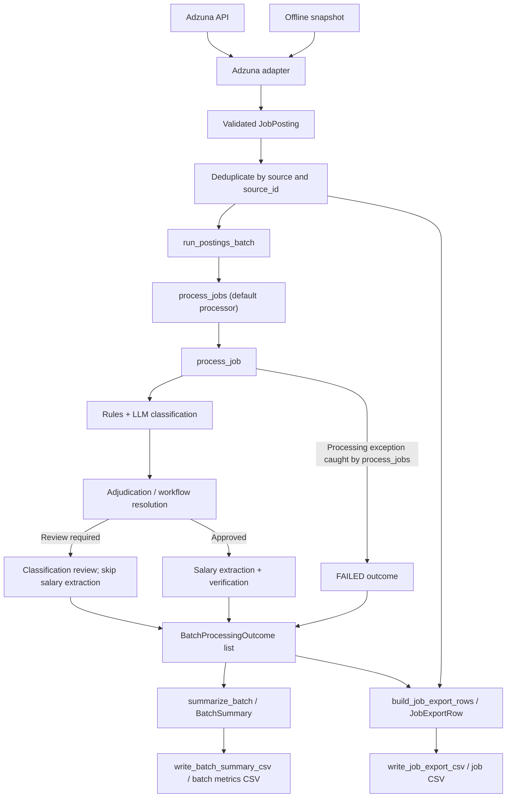

# UK Job Market Agents

A Python project exploring how AI agents, deterministic classification
rules, and data engineering techniques can be used to analyse the UK
data and analytics job market.

The project aims to transform job advertisements into structured,
validated datasets suitable for analysis and visualisation.

## Project Objectives

- Extract structured information from job advertisements.
- Classify roles into data engineering, data science, data analytics,
  and analytics engineering.
- Identify remote, hybrid, and onsite working arrangements.
- Extract and validate advertised salary information.
- Compare deterministic classification rules with LLM predictions.
- Identify classifications requiring further review.
- Produce reliable analytical datasets for downstream reporting.

## Architecture

The project separates responsibilities across several components:

| Component | Responsibility |
| --------- | -------------- |
| Pydantic models | Validate structured job advertisement data |
| Adzuna API client | Retrieve provider data with bounded pagination, validation/error handling and injectable transport |
| Ingestion pipeline | Fetch, adapt and deduplicate advertisements by `(source, source_id)` |
| Source adapters | Translate provider-specific advertisements into validated JobPosting objects |
| Classification rules | Apply deterministic role and working-pattern classifications |
| LLM classifier | Interpret job advertisements using a language model |
| LLM salary extractor | Extract structured salary quotations and supporting evidence |
| Salary verification | Check extracted values against evidence and assign review status |
| Evaluation | Compare classification results and measure performance |
| Adjudication | Help resolve disagreements between classification methods |
| Workflow | Coordinate classification results and review decisions |
| Orchestration | Coordinate single-job classification, salary verification and analytical record construction |
| Offline batch integration | Pass prepared postings to an injectable processor and return outcomes with a batch summary |
| Batch orchestration | Process advertisements sequentially, preserve outcomes and isolate failures |
| Batch metrics | Calculate validated processing counts and derived rates |
| Salary policy | Determine eligibility for annual salary analysis |
| Analytics | Construct analytical records and calculate summary metrics |
| CSV export | Serialize analytical results for downstream consumption |
| Job export | Join ordered postings/outcomes into provenance-aware rows, then serialize deterministically |
| Batch reporting | Serialize validated batch metrics into deterministic CSV output |



The diagram shows component relationships, not an executable end-to-end CLI.
Lesson 22 connects prepared postings to processing through `run_postings_batch()`;
it returns outcomes and `summarize_batch(outcomes)`. Lesson 23 adds the record-level
export boundary; Lesson 24 composes both CSV exports in `run_offline_workflow()`. Offline integration tests
use an injected processor; they do not demonstrate a live end-to-end LLM workflow.

## Job Advertisement Ingestion Contract

`JobPosting` provides the canonical internal representation of a job advertisement, independently of the external data provider.

Incoming advertisements must satisfy the following requirements:

- `source` and `source_id` must contain non-whitespace characters.
- `collected_at` must be a timezone-aware datetime.
- `raw_title` and `raw_description` must contain non-whitespace characters.
- `source_url` is optional but must be a valid HTTP/HTTPS URL when supplied.
- `company_name` and `location_raw` remain optional.

Validation rejects blank source fields and advertisement content without stripping or otherwise modifying valid raw strings.

Newly collected advertisements can retain their default `UNKNOWN` classifications and `UNVALIDATED` status until the processing workflows evaluate them.

The model preserves source identity and collection timestamps to support provenance and deduplication.

The Adzuna source adapter, `adapt_adzuna_job()`, translates provider-specific advertisement data into validated `JobPosting` objects. It preserves source identifiers, URLs, raw titles, descriptions, company names and locations where supplied.

`DescriptionCompleteness` distinguishes `COMPLETE`, `EXCERPT` and `UNKNOWN` advertisement descriptions. The Adzuna adapter conservatively marks descriptions as `EXCERPT`; other `JobPosting` instances default to `UNKNOWN`.

`process_job()` preserves source identity, collection timestamps, source URLs and description completeness in `OrchestrationResult`, whether classification succeeds or requires review.

The Adzuna retrieval client and ingestion pipeline support controlled live retrieval and offline snapshot replay (Lesson 21). Lesson 22 adds an offline batch integration helper for prepared postings. Lesson 23 adds a provenance-aware analytical export; persistent ingestion history remains future work.

### Lesson 20 — Adzuna API client and ingestion pipeline

- Implemented the Adzuna API client with bounded pagination and validation/error handling.
- Kept HTTP transport injectable so API behaviour can be tested with mocked transport and deterministic responses.
- Implemented `deduplicate_postings()` using `(source, source_id)`, preserving the first occurrence and first-seen order.
- Implemented `prepare_adzuna_postings()` to adapt raw advertisements into validated `JobPosting` objects and deduplicate them.
- Implemented `ingest_adzuna_jobs()` to coordinate fetching, preparation and deduplication, with injectable `fetch_pages` and transport dependencies.
- Passed the timezone-aware collection timestamp through the pipeline using the keyword-only `collected_at` argument.
- Verified the Lesson 20 pipeline with mocked transport/dependencies; live smoke support follows in Lesson 21.

Adzuna credentials must remain local and must not be committed, including in fixtures, documentation or request logs. Use the existing ignored secrets configuration and verify that credentials are excluded before committing.

**Compatibility:** Introducing timezone-aware collection timestamps required updating existing test fixtures. The full regression suite passed with 190 tests and one expected failure on 22 October 2026.

### Lesson 21 — Controlled Adzuna smoke and snapshot replay

From the repository root, with project dependencies installed in `.venv`:

```bash
# Default: replay the existing local snapshot; no credentials or HTTP calls.
.venv/bin/python -m scripts.smoke_adzuna
# Replay a different snapshot.
.venv/bin/python -m scripts.smoke_adzuna --snapshot data/raw/another_sample.json
# Fetch one UK page for "data engineer", requesting five results, and save it.
.venv/bin/python -m scripts.smoke_adzuna --live
# Choose the destination for a fresh response.
.venv/bin/python -m scripts.smoke_adzuna --live --snapshot data/raw/another_sample.json
```

Live mode requires `ADZUNA_APP_ID` and `ADZUNA_APP_KEY` in the environment;
the script does not load `secrets.json` automatically. Keep values in local
secret storage and inject them into the environment without recording them
in shell history. Never commit credentials or log the constructed request URL:
it contains credentials. The smoke script suppresses request exception details,
reporting only an HTTP status or a generic request failure.

The default snapshot is `data/raw/adzuna_sample.json`. Both `data/raw/` and
`secrets.json` are ignored and must remain untracked. A fresh checkout has no
snapshot: obtain one locally before replay. Custom paths outside `data/raw/`
are not covered by that ignore rule and must also stay out of commits.

Both modes adapt and deduplicate the response and print retrieved/validated
counts. The existing local snapshot replay produced **5 retrieved / 5 unique
validated postings** on 27 October 2026; no fresh live request was made during
this close-out.

The adapter now preserves publication time, paired coordinates, raw contract
and category metadata, and provider salary bounds/prediction status. Coordinates
must be in range and supplied together; publication times must be timezone-aware.
Provider salary bounds are non-negative and ordered, and remain separate from
interpreted salary fields. Prediction flags accept only `"0"`, `"1"` or `None`;
empty optional contract/category text becomes `None`.

**Testing:** `tests/test_smoke_adzuna.py` creates a synthetic temporary snapshot,
removes both credentials and replaces HTTP transport with a function that fails
if called. This guards the offline default without depending on a live API or
committed provider data. Run focused tests before the full suite:

```bash
.venv/bin/python -m pytest -q tests/test_smoke_adzuna.py tests/ingestion tests/test_job_posting.py
.venv/bin/python -m pytest -q -ra
```

**Caveats:** `--live` overwrites the chosen snapshot before adapting its adverts.
Replay assigns the current UTC time to `collected_at`, not the original fetch
time; the snapshot does not store that timestamp. Malformed JSON or an invalid
advert can stop the smoke run. Descriptions remain excerpts and predicted
salaries are provider metadata, not verified advertised salaries. This small
sample validates ingestion, not market coverage or end-to-end LLM processing.

### Lesson 22 — Offline batch integration

`src/uk_job_market_agents/ingestion/batch_integration.py` adds
`run_postings_batch(postings, *, processor=process_jobs)`, returning processing
outcomes together with `summarize_batch(outcomes)`. The default processor reuses
the existing batch and single-job orchestration; tests can inject a processor
without invoking live LLM services. Adaptation and deduplication remain upstream
responsibilities, handled for Adzuna payloads by `prepare_adzuna_postings()`.

Four tests in `tests/ingestion/test_batch_integration.py` cover populated and empty
batches, mixed outcomes, and synthetic Adzuna payloads prepared through
`prepare_adzuna_postings()`, including provenance and deduplication. This verifies
the offline integration boundary, not live end-to-end LLM behaviour. The duplicate
import in `tests/analytics/test_batch_summary.py` was also removed.

**State (verified 30 October 2026):** Committed at `9a672ee` on
`lesson/22-offline-batch-integration`. Lesson 21 commit:
`28fd5dc`. Batch metrics CSV export is available separately; no executable CLI
currently connects retrieval, processing and every export component.

## Lesson 23 — Provenance-aware job export

Agents/LLMs interpret advertisements; deterministic Python/Pydantic validates,
selects and serializes values. `build_job_export_rows(postings, outcomes)` in
`analytics/job_export.py` pairs the two ordered lists with strict length checking
and requires each `posting.source_id == outcome.job_id`. It preserves input order,
including failed and review-required advertisements. It neither sorts nor deduplicates.

Provenance and provider metadata always come from the original posting, even when
processing failed: source, source ID, timezone-aware collection time, description
completeness, company name and provider salary fields.

| Processing status | Exported analytical fields |
| --- | --- |
| `processed` | Role, work pattern and salary bounds from the analytical record, when present |
| `review_required` | Empty role, work pattern and analytical salary fields; classification review reason retained |
| `failed` | Empty analytical fields and review reason; source metadata retained |

Processing status describes classification/processing, not salary verification.
`salary_min` and `salary_max` copy the upstream analytical record. In the normal
`process_job()` path, only verified, complete GBP annual ranges qualify; daily,
hourly, incomplete, undisclosed or unverified salaries leave these fields empty.
The exporter does not reverify salary evidence. `source_salary_min/max` remain
provider values; `source_salary_predicted` distinguishes true, false and unknown.
Even a false prediction flag does not establish verified advertised salary.
Provider values never fill missing analytical salary bounds.

### CSV contract and offline usage

`write_job_export_csv(rows, output_path: Path)` in `analytics/job_export_csv.py`
writes this fixed 14-column schema:

```csv
source,source_id,collected_at,description_completeness,processing_status,role_family,work_pattern,salary_min,salary_max,source_salary_min,source_salary_max,source_salary_predicted,classification_review_reason,company_name
```

Identical ordered rows produce identical bytes in the same runtime: UTF-8 without
a BOM, LF record terminators and a final newline. Empty input writes the header.
Pydantic JSON serialization supplies enum values and ISO timestamps (UTC uses
`Z`; other timezone offsets are preserved). Missing values become empty fields;
booleans become `True`/`False`. Numeric values use ordinary Python CSV conversion
(no fixed decimal precision). Standard CSV quoting preserves commas, quotes and
embedded newlines; embedded source text is not normalized.

This complete example uses a synthetic failure and makes no API or LLM calls:

```python
from datetime import datetime, timezone
from pathlib import Path

from uk_job_market_agents.agents.batch_orchestration import (
    BatchProcessingOutcome, ProcessingStatus,
)
from uk_job_market_agents.analytics.job_export import build_job_export_rows
from uk_job_market_agents.analytics.job_export_csv import write_job_export_csv
from uk_job_market_agents.models.job_posting import JobPosting

postings = [JobPosting(
    source="fixture", source_id="001",
    raw_title="Data Engineer", raw_description="Synthetic offline example",
    collected_at=datetime(2026, 10, 30, tzinfo=timezone.utc),
)]
outcomes = [BatchProcessingOutcome(
    job_id="001", status=ProcessingStatus.FAILED,
    error="Synthetic failure for export demonstration",
)]
rows = build_job_export_rows(postings, outcomes)
write_job_export_csv(rows, Path("job_export.csv"))
```

For existing batch results, pass the same prepared postings and their returned
outcomes. The default batch processor invokes LLM workflows; use precomputed
outcomes or an injected offline processor when working offline.

**Limitations:** Pairing is positional and checks only source ID: outcomes lack a
required source-qualified identity, so cross-provider ID collisions cannot be
fully detected. Use outcomes from the same ordered batch. `JobExportRow` is a
typed serialization model, not an independent workflow/salary verifier; manually
constructed records can bypass upstream policies. A processed outcome with no
analytical record exports empty analytical fields. Excerpts remain explicitly
labelled and do not imply complete advertisement evidence. This selected schema
omits source URL, raw text, title/location, salary evidence/review status and
failure details; retain original postings/outcomes and the separate salary audit
export when those are needed. The writer overwrites an existing file, requires
an existing parent directory and does not write atomically. No CLI, persistence
or new live processing is introduced.

## Salary Validation and Analytical Records

Salary processing separates data validation, analytical eligibility,
and classification approval.

### SalaryQuote

`SalaryQuote` is a Pydantic model that validates salary information.

It ensures that:

- At least one salary bound is provided.
- Salary bounds are positive integers.
- Minimum salaries do not exceed maximum salaries.
- The payment period is recognised: year, day, or hour.
- The currency is GBP.

A valid salary quotation is not necessarily eligible for annual
salary comparisons.

### annual_salary_bounds()

`annual_salary_bounds()` determines whether a validated salary
quotation is eligible for annual salary analysis.

Only complete annual salary ranges are eligible.

Daily rates, hourly rates, incomplete annual ranges, and missing
salary quotations return `(None, None)`.

This prevents salaries expressed in incompatible payment periods
from being compared without an explicit conversion policy.

### build_analytical_record()

`build_analytical_record()` constructs an `AnalyticalJobRecord`
from an approved classification and its associated salary quotation.

The function:

- Accepts optional `company_name` and `location_raw` parameters,
  preserving the advertised employer and location. `process_job()`
  supplies these fields from the `JobPosting`.
- Returns `None` when classification review is required.
- Returns `None` when no resolved classification is available.
- Retains approved advertisements without eligible annual salaries.
- Populates annual salary fields using `annual_salary_bounds()`.

For example, an approved Data Engineer advertisement offering
£500–£600 per day remains eligible for role-family and working-pattern
analysis, even though its annual salary fields are empty.

## Salary extraction and analytical eligibility

The system uses structured LLM output to identify salary information and supporting evidence.
Deterministic verification assigns a review status before the extracted salary is considered for analytics.
All salary assessments can be exported to an auditable CSV, including those requiring review or containing no disclosed salary.
Only verified GBP annual salary ranges with both bounds present are eligible for annual salary statistics.
Daily and hourly rates are not annualised. Ineligible salaries are excluded from salary calculations without
removing their associated advertisements from job counts.

The single-job orchestrator `process_job()` applies the salary integration
adapter after salary extraction and verification. This path is covered by
orchestration tests. Lesson 22 connects prepared postings to batch processing
through an injectable helper; live end-to-end LLM processing remains unverified.

## Orchestration

`process_job(job: JobPosting) -> OrchestrationResult` coordinates the
single-job classification and salary workflows.

The orchestrator:

- Classifies the raw title and description, then resolves the classification.
- Builds an analytical record, preserving `company_name` and `location_raw`.
- Stops before salary extraction if classification review is required or no
  resolved classification is available.
- For an approved advertisement, extracts and verifies salary information
  from the raw description, then applies the salary assessment to the record.
- Retains the approved advertisement when salary review is required, salary
  is not disclosed, or the quotation is ineligible for annual analysis.
  Annual salary fields remain empty in these cases.

`OrchestrationResult` contains `classification` (`WorkflowResolution`),
`analytical_record` (`AnalyticalJobRecord` or `None`) and
`salary_assessment` (`SalaryAssessment` or `None`). When classification
prevents record construction, both optional fields are `None`.

Only verified, complete GBP annual salary ranges populate annual salary
fields. Classification review and salary review therefore have distinct
consequences: the former prevents an analytical record; the latter does
not remove an otherwise approved advertisement from job counts.

The single-job orchestrator is reused by the batch-processing workflow
described below.

## Batch Orchestration

The batch orchestration workflow processes multiple job advertisements
sequentially using the existing `process_job()` function.

`process_jobs()` returns a list of `BatchProcessingOutcome` objects,
preserving advertisement identifiers and input order.

Each outcome has one of three statuses:

- `PROCESSED`: Classification completed without requiring review.
- `REVIEW_REQUIRED`: Classification completed but requires review.
- `FAILED`: Processing raised an exception.

Pydantic model validators enforce consistency between processing status,
classification decisions, orchestration results, and error messages.

Individual processing failures are isolated so subsequent advertisements
can continue processing.

The current implementation is sequential and does not support
concurrency, retries, or persistent processing history.

## Batch Operational Metrics

`BatchSummary` provides deterministic aggregate statistics derived
from validated `BatchProcessingOutcome` objects.

The `summarize_batch()` function calculates:

- Total advertisements processed in the batch.
- Advertisements successfully processed.
- Advertisements requiring classification review.
- Advertisements that failed during processing.

`BatchSummary` also exposes three calculated proportions:

- `processed_rate`
- `review_rate`
- `failure_rate`

Rates range from 0.0 to 1.0. Empty batches return zero counts and
zero rates, avoiding division-by-zero errors.

Pydantic validation enforces non-negative counts and requires the
individual status counts to sum to the batch total.

Batch aggregation is deterministic and does not invoke an LLM.

The calculated rates are Python properties and are not currently
included in Pydantic's standard `model_dump()` output.

### Batch Metrics CSV Export

`write_batch_summary_csv()` serializes a validated `BatchSummary`
into a deterministic, single-row CSV report.

The export uses this fixed column order:

```csv
total,processed,review_required,failed,processed_rate,review_rate,failure_rate
```

Processing, review and failure rates are represented as proportions
between 0 and 1, formatted to six decimal places.
The exporter guarantees:

- A stable seven-column schema.
- Exactly one data row per summary.
- LF (`\n`) line endings and a final newline.
- Zero counts and zero rates for empty batches.
- Identical output for identical input summaries.

Serialization is separate from aggregation and does not invoke an LLM.
The exporter accepts a writable text stream, allowing output to
in-memory buffers or files.

## CSV Export Contract

`write_salary_analysis_csv` accepts a sequence of `SalaryAnalysisRow`
instances and writes aggregated salary-analysis results to a CSV file.

The exporter guarantees:

- **Column schema:** The following six columns are written in the specified order:

  ```csv
  dimension,segment,records,records_with_salary,average_midpoint,has_sufficient_sample
  ```

- **Deterministic output:** Identical input rows, supplied in the same order,
  produce identical CSV bytes. The exporter does not automatically sort rows.
- **Line endings:** The exporter uses LF (`\n`) line endings, regardless of
  operating system.
- **Missing values:** An unavailable `average_midpoint` is represented by
  an empty CSV field.

The export contains aggregated salary-analysis summaries rather than
individual job advertisements.

### Salary extraction CSV

`write_salary_extraction_csv()` exports individual salary assessments,
including verified, review-required, and not-disclosed results.

The export contains eight columns:

```csv
job_id,salary_min,salary_max,period,currency,evidence,review_status,review_reason
```

The exporter preserves input order, uses LF line endings, and represents
missing values as empty fields. Identical ordered inputs produce identical
CSV bytes.

This record-level audit export is separate from the aggregated salary
analysis CSV.

## Testing

The project uses pytest to validate model contracts, classification
behaviour, analytical policies, and workflow decisions.

Run the complete test suite:

```bash
python -m pytest -q
```

**Lesson 23 validation (30 October 2026):** **15 focused tests passed in 0.40s**;
full suite **259 passed, 2 skipped, 1 xfailed in 0.43s**. Credentials were removed
from the test environment; the two live OpenAI integration tests skipped.
The expected failure remains the remote-first / mandatory office-attendance rule.
No live API or LLM calls were made.

```bash
env -u OPENAI_API_KEY -u ADZUNA_APP_ID -u ADZUNA_APP_KEY .venv/bin/python -m pytest -q tests/analytics/test_job_export.py tests/analytics/test_job_export_csv.py
env -u OPENAI_API_KEY -u ADZUNA_APP_ID -u ADZUNA_APP_KEY .venv/bin/python -m pytest -q -ra
```

Current branch: `lesson/24-offline-workflow`; Lesson 23 baseline: `dc2eeb6`.
Lesson 24 is implemented and tested locally; nothing committed, merged or pushed.

## Lesson 24 — End-to-End Offline Workflow

`ingestion/offline_workflow.py` exposes
`run_offline_workflow(postings, *, processor, job_export_path, summary_export_path)`.
It accepts prepared `list[JobPosting]` values and returns `(outcomes, summary)`.
The processor is required: pass an offline fixture or deterministic processor.
The helper itself does not fetch advertisements or invoke an LLM; it cannot
prevent a caller-supplied processor from using the network.

The flow reuses `run_postings_batch()` → `build_job_export_rows()` →
`write_job_export_csv()` and `write_batch_summary_csv()`. Pairing is validated
before opening either output. Summary files use UTF-8 and `newline=""` so the
existing LF and six-decimal rate contract is preserved. Adaptation and
deduplication stay upstream. No new salary or provenance rules are introduced:
excerpts remain labelled, provider salaries never fill verified salary fields,
and only processed outcomes contribute approved analytics.

Runnable synthetic example (from the repository root with the virtual environment):

```bash
PYTHONPATH=src .venv/bin/python - <<'PYTHON'
from datetime import datetime, timezone
from pathlib import Path
from uk_job_market_agents.agents.batch_orchestration import BatchProcessingOutcome, ProcessingStatus
from uk_job_market_agents.ingestion.offline_workflow import run_offline_workflow
from uk_job_market_agents.models.job_posting import JobPosting

postings = [JobPosting(
    source="fixture", source_id="example-1", raw_title="Data Engineer",
    raw_description="Python and SQL",
    collected_at=datetime(2026, 10, 30, tzinfo=timezone.utc),
)]

def offline_processor(jobs):
    return [BatchProcessingOutcome(
        job_id=job.source_id, status=ProcessingStatus.FAILED,
        error="Synthetic offline example; no model processing attempted",
    ) for job in jobs]

outcomes, summary = run_offline_workflow(
    postings, processor=offline_processor,
    job_export_path=Path("offline_jobs.csv"),
    summary_export_path=Path("offline_summary.csv"),
)
print(summary)
PYTHON
```

**File contract and limitations:** Use distinct `Path` destinations with existing
parent directories. Same resolved paths and existing symlink/hard-link aliases
are rejected before the processor runs. Existing outputs are overwritten.
Processor and pairing failures propagate before writing; I/O failures propagate
without rollback. The two writes are not atomic: a summary write failure can
leave a completed jobs export. No CLI, fetching, retries, persistence or new
validation framework is added. This is an offline integration boundary, not
proof of live processing or salary verification.

**Validation (30 October 2026):** 12 new workflow cases; combined focused tests
**35 passed in 0.23s**; full suite **271 passed, 2 skipped, 1 xfailed in 0.46s**.
Credentials were removed; live OpenAI tests skipped. New workflow tests block
socket connections and cover empty/mixed batches, Unicode provenance, separate
provider/analytical salaries (including missing verified salaries), suppression
of review-required analytics, deterministic bytes, mismatches without file
changes, and colliding destinations. The known classification-rule xfail remains.
The supplied baseline of 261 passed includes the two tests skipped here;
259 offline passes plus 12 new cases yields 271.

```bash
env -u OPENAI_API_KEY -u ADZUNA_APP_ID -u ADZUNA_APP_KEY .venv/bin/python -m pytest -q tests/ingestion/test_offline_workflow.py tests/ingestion/test_batch_integration.py tests/analytics/test_job_export.py tests/analytics/test_job_export_csv.py tests/analytics/test_batch_output.py
env -u OPENAI_API_KEY -u ADZUNA_APP_ID -u ADZUNA_APP_KEY .venv/bin/python -m pytest -q -ra
```

## Current Limitations

- Batch processing is sequential, without concurrency, retries or
  persistent processing history.
- The project currently relies on a small collection of example
  job advertisements.
- Adzuna retrieval, snapshot replay and prepared-posting batch integration exist,
  but a live end-to-end LLM workflow has not been verified. No executable CLI
  connects all retrieval, processing, summary and export components.
- Adzuna descriptions remain excerpts, and provider salary metadata is not
  verified salary evidence. Replay does not preserve the original fetch time.
- Analytical records do not currently preserve original salary
  quotations.
- Lesson 23 exports selected provenance and analytical fields; detailed salary
  assessments and failure diagnostics remain separate.

## Planned Development

1. Review Lesson 24; staging, committing and integration require a separate request.
2. Next milestone: a snapshot-backed offline command using the workflow helper, with an explicit processor policy. Define excerpt and provider salary policies before controlled live processing.
3. Develop analysis-ready datasets with appropriate provenance.
4. Build operational monitoring and job-market dashboards.
5. Investigate processing retries, persistence and concurrency where justified.
